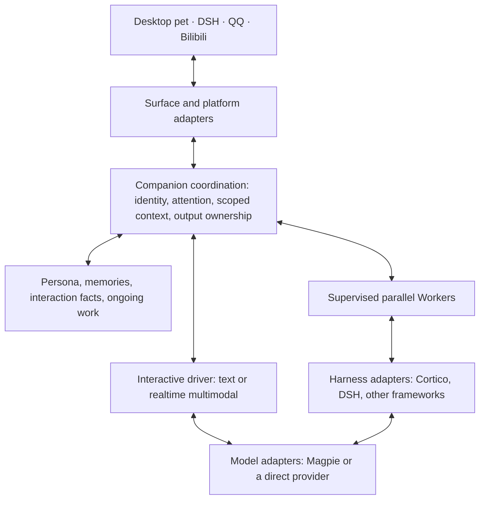

# Independent continuous Agent: design in progress

Status: **Independent ownership and the Session-free user model are accepted in [ADR-0015](../../../docs/adr/0015-independent-continuous-agent-runtime.md); cloud-capable service deployment and pluggable features are accepted in [ADR-0016](../../../docs/adr/0016-cloud-service-and-pluggable-features.md). Detailed contracts and release scope remain in planning.** Requirements are owned by [the PRD](prd.md); source findings live under [research](research/ecosystem-and-duplex.md).

## Selected product shape and ownership

The user selected an independently maintained product engine/runtime on 2026-11-07. One continuous Agent is the user-facing identity; multiple supervised Workers may execute through different Agent Harnesses. Session creation, selection, compaction and replacement are internal responsibilities, not routine user workflows.

The project runtime owns companion identity, accepted memories, logical work and cross-surface coordination. Retain useful existing plugin/task/configuration/permission mechanisms rather than build another generic host or reimplement every harness's model/tool loop. Adapt Cortico first where it helps preserve current behavior; DSH and other harnesses can become optional execution/tool adapters. A DSH page can also be a surface of the same independent Agent.

The rejected primary-host alternative and its evidence remain in [the research handoff](research/index.md). DSH hosting was technically viable; it was not selected because product-owned lifecycle and broad harness substitution are the priority. Do not continue treating A/B hosting as an open question or implement two production host authorities.

The user selected independently deployable service hosting, including cloud deployment. The service must boot without Electron or local media devices. Electron remains one useful local client for existing native pet/device work; it is not the identity or task owner. Specific cloud platform, packaging and client shells remain implementation choices. Core availability follows the service and its dependencies, not the desktop window.

## Minimal kernel and plugin composition

Product ownership is a data/lifecycle responsibility, not a requirement to hardcode every feature in the kernel. Keep these mechanisms stable while their declared providers and policies remain replaceable:

| Stable kernel boundary | Replaceable implementation or feature |
| --- | --- |
| Plugin lifecycle, versioned capabilities, dependencies, ownership/generation and cleanup | Harnesses, model gateways, platform connectors, UI and native capability plugins |
| Stable Agent/task/attempt/surface identities and authorized state-commit rules | Persona content, context assembly, memory extraction/retrieval/indexing and storage backends |
| Tracked execution, correlated receipts, cancellation scope and actual drain | Worker placement, scheduling/attention policies and harness-native execution loops |
| Authenticated client admission, capability grants, event correlation and delivery | Client shells, transport adapters, notification channels and connected execution environments |
| Control/state access and minimal management/diagnostics | Task boards, settings pages, chat interfaces, voice input/output and Live2D/avatar/outfit presentation |

A default distribution may compose a persona, memory provider, scheduler, model adapter and interaction entry for an immediately usable Agent. These are defaults, not a second class of mandatory feature plugins. With no interaction plugin, the core can remain manageable without pretending a conversation channel exists. With a required state or execution provider unavailable, report the affected capability as unready; do not silently create another identity/store or enable a replacement the user did not select.

Use the same extension model for server-side, client-side and coordinated parts. Location is not a hierarchy. For example, a voice module can compose local capture with a cloud recognizer; an avatar module owns local rendering; a task board consumes the service's task contract. Removing their presentation does not delete task/persona data. Registered capabilities and owned resources are withdrawn according to the plugin's declared lifecycle.

Replacement has distinct boundaries: a view can withdraw; a worker provider must cancel/drain or report unsupported cleanup; a state provider needs compatible access or explicit migration. Preserve a stable product data namespace rather than attaching enduring identity/work to the current UI/Harness plugin ID. No claim of arbitrary lossless hot replacement follows from using plugins.

## Cloud computation, durable state and execution environments

Treat these as separate responsibilities, without assuming a distributed cluster for the first release:

1. **Service/compute instances** receive events, coordinate interaction and run eligible Workers. They may be restartable or containerized, but temporary process memory must not be the sole record of accepted work. Some Harnesses need their own working files/checkpoints; the adapter must declare and externalize or restore them before that worker can be called stateless.
2. **Durable state providers** retain character/profile revisions, accepted memories, logical tasks, execution/effect receipts, event cursors and supported checkpoints. A database is a candidate implementation, not a selected vendor. Large media, generated artifacts and workspaces belong behind file/object storage capabilities with stable references rather than unbounded database event payloads.
3. **Execution environments** provide actual tools/files/devices. R18 selects a basic cloud execution environment for the first usable version: cloud Workers use its configured tools and available/authorized materials for file/code work and durable artifacts without depending on the local PC. A local daemon complements it with authorized native/private-device capabilities; another device requires explicit configuration. This is not automatic synchronization or relocation of private local work. Model inference placement is a separate provider choice.
4. **Interaction clients** present the same Agent and report actual device/playback outcomes. A thin local daemon has no independent canonical Agent memory/task store. Credentials, device grants and a minimal operation-receipt record may still need local persistence; “thin” does not imply that every safe execution fact can be discarded.

While a laptop is off, cloud-eligible work can continue and other connected platform adapters can still receive/send authorized messages. A task requiring that laptop's private files or native desktop cannot run there until it returns. Moving that work to a cloud environment requires the necessary data, software and grants; it is not an automatic consequence of cloud deployment.

The service owns canonical product state; the device is authoritative about its actual availability and physical effects. Commands need precise device/task/operation identity, authority and a freshness boundary. Local stop must work without a round trip. After connection loss, do not claim a remote stop arrived, a device effect never happened, or a cloud task is currently running merely from the last snapshot. Reconcile accepted commands and real receipts on reconnect; replaying history must not replay effects or stale audio. Materially conflicting user intents remain business decisions, not permission to overwrite local drafts blindly.

Client reconnect and compute restart are separate recovery cases. Persisted task metadata permits recovery decisions, not automatic continuation of an arbitrary process, hidden model state or in-flight side effect. Record known completion, supported resume and uncertain outcomes distinctly. Multi-tenant SaaS, an autonomous offline client and global dual-writer synchronization are not selected requirements.

Keep control facts and media transport distinct: durable task/input/result events use the service protocol; PCM/video streams and asset transfer use bounded media channels or a provider-supported direct path. Local reflex feedback and stop behavior do not wait for a cloud classifier. Authentication/capability scope and playback receipts still bind a direct media path to its product task.

## Candidate logical boundaries

These are responsibilities, not six new frameworks or mandatory processes. Initial implementation should reuse existing owners and introduce boundaries only where demonstrated coupling or a selected behavior requires them.

The minimal-kernel table above owns the stable/replaceable boundary. Each implementation declares its capabilities, lifecycle and compatibility; platform, model and Harness adapters preserve origin, task and output correlation. The contracts do not assume identical modality or recovery behavior across providers.

## Continuous identity, work and internal execution

R10–R12 establish independent lifetimes:

| Concept | Owner and lifetime | User experience |
| --- | --- | --- |
| Product Agent | Product-owned identity, relationships and accepted experiences across interactions | The same assistant through every supported surface |
| Logical task | User intent, status, results, audience and committed effects; independent of one execution attempt | Describe, inspect, revise, pause/stop or continue meaningful work |
| Worker | Supervised execution instance using a harness, scoped context and granted capabilities | Normally internal; task progress is visible without requiring Worker management |
| Agent Harness | Implements its own model/tool/context execution semantics and declares integration capabilities | Optional advanced configuration; no routine choice required per request |
| Execution Session | Harness-owned context/log/checkpoint, selected or recreated by its adapter | No required create/select/compact/repair workflow |
| Interaction scene | Platform, participants, audience and current conversational situation | Users can refer to work naturally without exposing unrelated private contexts |

A task can use several Workers or execution attempts. Neither Worker ID nor Session ID is the product task key. A Worker is not necessarily an OS process. Start with the task/attempt relationship needed by the selected slice rather than inventing an arbitrary workflow graph.

The runtime determines what work belongs together and supplies an eligible context snapshot. A harness determines how it executes that work. The adapter translates input, progress/results, interruption, terminal/drained state and any supported checkpoint operations; native advanced features remain explicit. Framework-owned session formats do not leak into platform adapters or become the sole home of personality and memory.

The DSH adapter must respect DSH's Session-bound native Agent interface, single factory registration and external-child capability limits; these constraints stay behind that adapter. [The verified DSH follow-up](research/ecosystem-and-duplex.md#dsh-follow-up-other-frameworks-and-cross-session-coordination) remains the integration reference. Superagent's independent work records and execution sessions are a useful pattern, not a reason to adopt its complete GitHub-oriented domain model.

Preserve both kinds of truth: the companion domain owns accepted long-term facts and work state; each execution log records what that execution actually saw and did. Inject scoped, versioned context rather than concatenating every transcript or making two stores authoritative for the same fact. Private provider checkpoints remain engine-specific.

## Event-driven foreground and background execution

R16 selects the behavior illustrated by the user's asynchronous ReAct timeline. Exact tool names are not frozen. A long operation is explicitly admitted into supervised work and returns a bounded receipt promptly; its result later re-enters as a system/tool fact. Short bounded operations may still return their result directly. Merely using an event bus or returning a JavaScript Promise does not provide this separation.

Proposed flow:

1. A start request is validated and registered under the Agent, logical task, execution attempt, origin/audience and cancellation scope. A successful receipt means that the system accepted and can track the work, not that its effect completed. If it is queued rather than running, report that distinction. Durable acceptance/dispatch coordination must be established before claiming restart-safe acceptance.
2. The foreground driver becomes available for further input. Incoming user events are incorporated at its next supported inference-step boundary, rather than after an entire long tool run or multi-step turn. A backend task does not implicitly own the frontend turn's cancellation lifetime.
3. Progress, completion, failure and real effects are recorded under the same work identity. Completion is delivered to the continuous Agent and relevant logical task, then mapped into the currently eligible context by the adapter. It is not addressed only to the original ephemeral Session or whichever conversation happens to be active.
4. The interaction policy decides whether to respond now, combine notices or wait; those policies remain pluggable. A result becoming available is distinct from a user actually receiving, seeing or hearing it. Worker completion does not directly seize a speaker or publish to another audience.
5. Stop requests target the permitted task/execution. Acknowledging cancellation, actual termination, settled work and an already committed effect are distinct facts. If completion races with stop, preserve the observed effect and final outcome; do not rewrite completed work into a fictional rollback. Disconnecting a caller is not proof of remote cancellation.

Events need stable identities and correlation, attributable source, audience/destination and versioned payload semantics. Deduplicate delivery to avoid applying the same result twice; do not promise network-wide exactly-once effects. Persist terminal work facts and required pending delivery state, coalesce disposable progress where appropriate, and do not append every audio frame/token to the durable semantic log. Logs and media are retrievable by bounded references rather than injected wholesale into a model prompt.

Model-facing receipts should name the work, its known status and how to retrieve details or request cancellation. Completion events include a concise result and enough originating-task context to interpret it after foreground conversation has moved on. They remain tool/system observations, not fabricated user instructions. Models need not busy-poll each job; an adapter may poll a vendor API internally when that is the vendor's supported mechanism and emit a normalized completion event.

Cortico's World/WakeBus already supports event ingress and flush/debounce/piggyback/preempt/interrupt behavior, but the current local adapter awaits full capability results. The native fork API is not a ready-made durable, cancellable background worker. Reuse the project's TaskSupervisor and make independent work explicit rather than detach ordinary nested tool calls or add another task manager. See [upstream evidence](research/upstream-runtimes.md#core-bus-and-sessions) and [local task/cancellation evidence](research/current-runtime.md#can-a-qq-video-job-continue-while-the-desktop-user-interrupts-speech).

Step-boundary responsiveness is not mid-inference injection or native audio duplex. Continuous capture and immediate local playback stop use the independent media/control path; the text/Harness driver consumes semantic changes at its supported safe point. Optional preemption and native realtime capabilities are negotiated per adapter.

Proposed proof: keep a short synchronous tool; start a deliberately slow tool and receive its receipt before completion; admit a second user input at the next supported step while that tool continues; deliver one correlated completion across Session reconstruction; and exercise stop during admission, execution and completion races. Reconnect/redelivery must neither lose the result nor redo a committed effect. None of these experiments ran during planning.

## User control without Session management

Ordinary interaction is with the Agent, ongoing work and results. The user can ask what is running, change a goal, inspect a failure, stop a task or request an artifact without opening the session where it executed. Everyday chat need not first become a formal goal or task. Optional diagnostics may expose technical execution traces; ordinary workflows must remain usable without them.

Task/history/topic views, if useful, organize human intent and outcomes rather than mirror a harness's session list. Their navigation is still a UX proposal. Hiding Sessions does not imply a single enormous timeline, global serialization, mandatory goal taxonomy or a ban on advanced controls.

For ambiguous references such as “continue that one,” resolve against the current scene, explicit recent references and eligible ongoing work. Ask in task language only when ambiguity materially changes the outcome; never ask the user for a Session ID. Cheap reversible UI focus can be inferred more freely than starting a costly job, changing recipients or publishing. Exact autonomy, memory-capture defaults, retries and notification policy are not decided by this rule.

Workers return attributed progress/results. An output owner coordinates presentation for the target conversation/device; concurrent work and independent platform responses need not share one global lock. A new input or stopped utterance does not silently cancel an explicitly independent background task.

The proof sequence and recovery distinctions are maintained once in [Phase 1 of the plan](implement.md#phase-1--prove-the-service-plugin-and-asynchronous-execution-boundaries). Product acceptance anchors P1–P10 live in [the PRD](prd.md#product-acceptance-anchors-for-the-selected-direction). They cover parallel Workers, internal Session handling, correct task/result ownership, supported replacement, cloud/client lifetimes and asynchronous tools; none is marked as a passed implementation test.

## One personality, scoped context

The proposed product identity has several distinct elements:

- **Stable persona:** name, core traits, speaking style, relationship conventions and self-description, versioned and user-editable.
- **Relationship memory:** durable preferences, commitments and shared experiences tied to an explicitly linked user identity.
- **Situation and short-term state:** current platform, audience, topic, attention and temporary affect; these can vary without inventing another persona.
- **Interaction facts:** observed input, accepted actions, displayed text, played audio and delivery outcomes with provenance.
- **Knowledge sources:** documents and retrieved evidence; separate from what the assistant personally experienced or promised.
- **Engine state:** prompts, transcript projections, caches and provider-specific checkpoints used by the current driver.

Shared memory does not require sending the whole historical corpus to every model. Build each working context from the same authorized facts plus the current conversation. Public/group answers should use an appropriate projection; a private preference can influence permitted tone without exposing a private anecdote. Exact sharing defaults require a user decision.

A single character can participate in concurrent conversations. Use one output owner for a given conversation/device, and serialize conflicting persona/memory updates. Do not impose a global lock across unrelated inference or background tasks. The identity is stable; a single never-ending model context is not required.

Cross-platform user linking must use explicit account binding, not equal nicknames. A Bilibili audience member is not implicitly the owner who chatted privately through the pet. Platform origin, audience and task correlation must survive delegation and delivery.

Personality continuity is an evaluated behavior, not guaranteed by repeating a system prompt. Acceptance should test the same preference, commitment and event across surfaces, restarts and an engine switch, including consistent limits when information was never visible to that context.

## Duplex interaction and emotion

The frontend should represent independent facts: capturing/listening, output playing, foreground reasoning and background jobs can coexist. An exclusive `listening | thinking | speaking` state is insufficient.

The fast interaction path should not wait for complex reasoning. Local touch/drag/stop reactions can be deterministic. A lightweight classifier can help with ambiguous intent, attention or expression choice, but only after measuring whether it improves the actual decision. It should not mediate every audio frame, keystroke or animation tick.

For a cascaded voice path, stream ASR hypotheses, text output and TTS audio where supported, with a deliberate policy for revisions and committed meaning. Partial ASR text is not an authorization to execute an irreversible action. For native speech models, use a dedicated session contract and keep native timing and interruption semantics; do not flatten it into a completed chat response.

Interruption must distinguish:

1. Stop audible output and flush its pending buffer.
2. Redirect/cancel the current conversational response.
3. Cancel an explicitly selected background task.

The first operation must not implicitly imply the third. Track generated versus actually played audio so the next response does not assume the user heard the interrupted ending. Use provider-native truncation when available and a truthful context projection otherwise.

Voice, text, expression and animation should derive from one semantic expression intent plus real playback timing. A reaction may acknowledge receiving input; it must not falsely claim task completion. Temporary emotion should remain context-sensitive, bounded and coherent with the chosen persona, rather than a random mood generator.

Performance experiments should separately measure local feedback, first meaningful text/audio, interruption-to-silence, routing overhead, background-result delivery and p50/p95 under load. Do not adopt the Higgs announcement's 160 ms chunk as an end-to-end product target. New Higgs Duplex API access is officially waitlisted as of this research; the currently documented Higgs Realtime API is a separate integration option.

## Multi-model routing and Magpie

There are three different routing decisions:

| Decision | Example | Proposed owner |
| --- | --- | --- |
| Interaction/attention | Whether to speak now, where to answer, whether an interruption targets speech or work | Companion interaction policy; may consult a classifier |
| Semantic work/model role | Quick dialogue, deep reasoning, visual understanding, image generation, video generation | Replaceable product routing policy, possibly delegated to an explicit Magpie intent group |
| Provider transport | Endpoint, credential, model-group member and supported retry/failover | Magpie or another model adapter |

Magpie can expose both model transport and intent routing; use its actual capabilities instead of reimplementing the same classifier twice. Fixed-source inspection also confirms a dedicated `POST /v1/systemone` decision API, streamed TTS, file ASR, image generation/editing and video create/status/content routes. The Responses WebSocket is not a native realtime audio session, and the standard video routes do not establish universal cancel/delete semantics. The product still owns who is speaking, which context is eligible and which output/task is being changed. See [gateway evidence](research/magpie-routing.md) and [Pi's Jev reference](research/ecosystem-and-duplex.md).

Candidate roles are `interactive`, `classify`, `reason`, `vision`, `embed/rerank`, `image`, `video`, and `realtime`. These are a capability checklist, not final plugin IDs or an assumption that one endpoint supports all of them. Prefer capability-aware selection over the UI fiction of one interchangeable “model” dropdown.

Routing is useful when the savings from avoiding an unsuitable/expensive model exceed classifier and network cost. Compare a deterministic route, a classifier-assisted route and a direct model call. Keep a chosen provider stable during dependent tool/stream steps unless the protocol explicitly permits switching. Preserve model identity and opaque replay data within their compatibility domain; do not claim KV-cache or native audio-session portability across providers.

Image/video generation should return a tracked job or bounded result and durable artifact reference. The assistant can continue conversation while a long task progresses. Completion re-enters the owning context as an event, with the original request/audience attached. Do not emit an old result into whichever conversation is currently active. “Stop waiting” and “provider confirmed cancellation” must remain distinguishable.

## Current implementation migration seams

The existing code already offers a unified plugin model, host-owned tasks/configuration/permissions, a shared profile, media ownership and a Cortico agent plugin. Preserve these assets while verifying the actual limitations recorded in [the local report](research/current-runtime.md).

Known seams independently checked by the coordinator:

- [Voice entry](../../../plugins/voice-chat/src/index.ts#L32) waits for completed ASR before invoking the agent.
- [Cortico provider boundary](../../../plugins/agent-cortico/src/agent.mjs#L273) awaits a complete `llm.responses@1` result; streaming options are not propagated through this adapter.
- [Speech publication](../../../plugins/agent-cortico/src/agent.mjs#L157) writes a full text reply, then archives it. This is not proof of audible playback.
- [Provider response](../../../plugins/llm-provider/src/responses.mjs#L177) returns a full Generation; the browser stream callback is currently empty.
- [Reply completion](../../../apps/desktop/src/main/demo-controller.ts#L891) sets the demo phase to idle before handing text to speech output, while [pet state projection](../../../apps/desktop/src/renderer/pet/App.tsx#L385) uses the demo/view state. The interaction review identifies a missing link from actual playback to visible speaking state. This is a source-backed integration finding, not an observed device test; it should be included in the first UX validation slice.

The first abstraction should wrap the current engine without creating another writer. If history ownership later moves, pause/drain admission, export supported facts, migrate once and switch the sole writer. Retain old data read-only; engine sessions then become derived working state. Do not run two writable conversation stores and try to reconcile them indefinitely.

Cortico can remain the first adapter while these boundaries are tested. Its upstream streaming changes are research evidence, not a sufficient fix for local adapters that discard streaming. Superagent is a DSH orchestration bundle, not a drop-in Cortico model engine; reuse its work-item/execution/outbox concepts or integrate it through DSH where appropriate. See [upstream comparison](research/upstream-runtimes.md).

## Candidate first vertical slice

The first implementation should prove the service/client boundary, removable feature plugins, asynchronous foreground/background work and supported Harness replacement before expanding to every platform. The executable sequence is maintained in [Phase 1 of the plan](implement.md#phase-1--prove-the-service-plugin-and-asynchronous-execution-boundaries); remaining scope and policy decisions are in [the PRD](prd.md#open-product-decisions). Exact protocols, live-account integrations, latency targets and recovery behavior remain unimplemented. Accepted architecture and continuity criteria do not by themselves approve the complete implementation roadmap.
