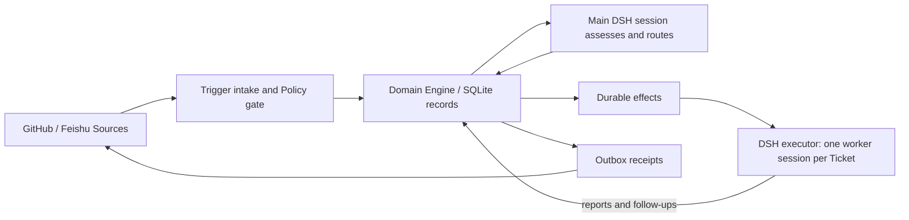

# Upstream runtime evidence: Cortico and DSH Superagent

Research date: 2026-11-06. Status: **research and candidate design only; no implementation or dependency upgrade approved**.

## Conclusion

Cortico is already a usable standalone, event-driven agent harness with an injectable model client, one persistent event-receiving session, temporary forks, output streaming hooks, and cooperative interruption. Its current upstream version improves several behaviors but does not introduce a native continuous audio/video duplex model. Upgrading alone would not make this project's current request/response adapter stream to the pet.

DSH Superagent is a **DSH bundle implementing proactive work orchestration**, not a substitute standalone inference or companion engine. Its domain `Engine` is unusually well separated and can inform, or potentially be extracted into, a DSH-independent work service. Its actual executor, sessions, delivery, tool registration, permissions, and UI are DSH integrations. Reusing that package as shipped brings DSH with it; reusing its work lifecycle does not require doing so.

The useful invariant is one companion identity and one authority for interaction policy, with bounded contracts for the chosen engine, asynchronous work, and a future realtime model session. **The canonical host is undecided: DSH may be the required primary host, or the application may operate independently.** Cortico is an existing engine candidate; Superagent's work lifecycle is relevant under either host choice, with different integration costs. Persisted persona, explicit memories, scoped conversation facts, and task checkpoints are portable; model activations, KV caches, signed reasoning, live audio decoder state, and in-flight protocol state are not a generic portable “mind.”

The Higgs announcement distinguishes the products explicitly: the new **Higgs Realtime Duplex API is “coming soon” with an API waitlist**, while the existing **Higgs Realtime** is available today. Public availability of Duplex weights was not substantiated. See the [announcement's “Try it” section][higgs-try].

## Scope and method

Read the [task PRD](/home/kingBZ/DeepSeek-WorkSpace/dsh-pet/.trellis/tasks/11-06-unified-companion-architecture/prd.md) and [Cortico ADR](/home/kingBZ/DeepSeek-WorkSpace/dsh-pet/docs/adr/0014-cortico-agent-runtime.md) first, then incorporated the user's R9 clarification and both ADR review notices. The [historical standalone decision](/home/kingBZ/DeepSeek-WorkSpace/dsh-pet/docs/adr/0002-standalone-with-optional-dsh.md) and current Cortico integration describe existing implementation, not constraints against choosing DSH as the required main host or replacing the engine. Primary host ownership and visible entry points remain separate, unresolved decisions. The [earlier reuse research](/home/kingBZ/DeepSeek-WorkSpace/dsh-pet/.trellis/tasks/archive/2026-10/10-28-plugin-settings-redesign/research/cortico-reuse.md) was treated as historical context and checked against source.

Cloned the two user-supplied repositories into a unique temporary research directory, created a detached checkout of the Cortico pin, read source and relevant tests, and compared commits with Git. **No upstream code, install script, build, or test was executed.** Test references below are inspected regression specifications, not successful test runs. GitHub HTML fetches timed out; the repository clones supplied the primary code evidence. Source content and setup instructions were treated as untrusted data.

| Repository / artifact | Exact observed revision | Version and date | License evidence |
| --- | --- | --- | --- |
| Cortico project pin | [`cb9ddbd685bcccba1f29905098648f46a79b3862`][c-pin-commit] | 0.2.7; commit timestamp 2026-10-24T15:17:44-05:00 | [MIT, copyright 2026 Phantivia][c-pin-license]; [manifest][c-pin-package] |
| Cortico fetched `origin/main` | [`c376b91c1ebbc69fe7a9a27e152d4b53cb2aebdb`][c-head-commit] | 0.2.13; commit timestamp 2026-11-04T15:18:41-06:00 | [Same MIT notice][c-license]; [manifest][c-package] |
| DSH Superagent fetched default branch | [`8c32a9dc5d72c033816c6a8110b37f40cf94fba4`][s-commit] | 0.1.0; commit timestamp 2026-10-31T20:06:31+08:00; the fetched history contains one commit | [MIT, copyright 2026 DeepSeek Harness Team][s-license]; [manifest][s-package] |

These are source snapshots observed during this research, not a claim that their npm release artifacts were independently verified. Preserve copyright and license notices when copying substantial source. Cortico's root README identifies its separate VTuber extension as having its own AGPL-3.0 + CLA license; the main repository's MIT license must not be assumed to cover every extension, model, or character asset ([README lines 49–53][c-readme]).

## 1. Cortico: what actually exists

### Core, Bus, and sessions

The [Core constructor][c-core] constructs the event store, WakeBus, session log, transcript, state, timers, provider registry, and usage/tool logs. It attaches the Persona, reads its session declarations, and throws unless **exactly one** declaration is both `persistent` and `receivesEvents`. Core connects the bus's preemption callback to `loop.interruptCurrentRound()` or `loop.abortCurrentRound()`.

[WakeBus][c-bus] is an ordered batching queue with **one waiting consumer**, not a multi-agent scheduler or media transport. Its five triggers are:

| Trigger | Verified meaning | Boundary relevant to a companion |
| --- | --- | --- |
| `flush` | Make the batch deliverable immediately. | Does not, by itself, cancel a running model request. |
| `debounce` | Batch by quiet gap, minimum/maximum age, and size. | Useful for bursts of platform events; not a microphone clock. |
| `piggyback` | Queue without independently waking the consumer. | Appropriate for facts that can wait for a later wake. |
| `preempt` | Ask to cancel an unexternalized model round. | Cannot retract already externally visible output or interrupt running tools. |
| `interrupt` | Abort the model round, retaining externalized output; signal interruptible tools and skip unstarted calls. | Requires downstream cancellation and truthful partial-output handling. |

These meanings are implemented in [the bus][c-bus] and [the loop's cancellation methods][c-cancel], and declared in [TriggerMode][c-triggers]. Operator pause and the Persona delivery gate take precedence. Incoming events are incorporated at model/tool-round boundaries or after a cancelled round, not injected into the hidden state of a model request already generating.

Events have a global cursor across runs. The in-memory wake queue is not persisted; startup replays eligible external events after a persisted delivery watermark, with withdrawal handling ([Core guide][c-core-guide]). This is useful recovery machinery, but not a distributed event log or cross-resource transaction: [event append][c-event-append] changes the in-memory collection/cursor before disk append, and [transcript append][c-transcript] catches write errors. Do not claim crash-atomic exactly-once execution of external tools from these facilities.

[Temporary forks][c-fork-core] bind a provider at creation, take caller-supplied context, run a bounded tool loop, and return text. They are not Superagent-style durable worker sessions. In both inspected Cortico revisions, [ForkOptions][c-session-types] has no cancellation signal and [runForkLoop][c-fork] does not pass a signal to `respond`; it checks `stopWhen` after tool execution. A fork's observation records and running counters do not supply a durable inbox, next-step steering, persistent job ownership, or mid-request cancellation. Those must not be promised by simply mapping `Executor.start/deliver/stop` onto `spawnFork`.

### Persona, Memory, World, and Provider

The [Persona interface][c-persona] defines prompt segments, lifecycle hooks, context handoff, session declarations, optional cognition, and optional opaque `memory`. Core does not query a standard semantic-memory backend. The current [Memory-backend guidance][c-persona-doc] explicitly says the Persona owns the storage implementation; retrieval tools, context assembly, timeouts, permissions, and conflict handling belong there. `memoryDir` and the synchronous `BlobStore` contract remain part of the interface even when the actual memory backend is remote. Replacing a database is feasible; retaining identical recall and context semantics is separate work.

The [World interface][c-world] provides environment prompt variables, tools, lifecycle, optional output taps, and settlement/run-phase notifications. [WorldHost][c-world-host] exposes event ingress, event reads, pending-event operations, model facts, blob lookup, usage reporting, and optional cognition. World events can wake the agent without a user chat message. World modules do not directly own Persona memory.

The [Provider contract][c-provider] normalizes native model protocols to Responses-shaped `Request` / `Generation`; [GenerateOptions][c-generation] supplies `onEvent`, `signal`, context records, and provider metadata. A Promise-returning `respond` can still deliver live incremental events through `onEvent`; the Promise's final `Generation` is the settled result, not proof that streaming is absent.

`CoreDeps.llm` is a useful injection point but does not remove every provider dependency. [Core][c-core] still constructs `ProviderRegistry`; context limits and model facts still use configured provider metadata. [Registry discovery][c-registry] performs a top-level filesystem scan/import of provider modules. This remains a Node/TypeScript integration with source/package-layout concerns, not a browser-only engine or a JSON-only service API.

The upstream [World compatibility document][c-world-compat] gives an actionable compatibility ladder:

- **L1:** tools, environment prompt, results/attachments, start/stop.
- **L2:** event ingress/wake, event provenance, tool barriers/turn endings, tool cancellation, model facts and blobs.
- **L3:** exact batching/preempt/interrupt/deferred/candidate/ephemeral/withdrawal/settlement semantics.
- **L4:** output tap, optional Persona cognition, stalls, and run-phase notifications.

The table rates console, QQ, and Bilibili at L3, Minecraft at L3 minimum/L4 complete, and the external VTuber World at L4. Therefore a generic “tool adapter” does not establish QQ/VTuber compatibility. This is a strong reference for bounded capability negotiation if Cortico is later replaced.

### Streaming and interruption, without overstating duplex

[OutputTap][c-output-tap] accepts model stream events and exposes `externalizes`, `onRoundEnd`, and `onAbort`. The default externalization rule counts text/refusal deltas and function-call introduction. It is an observation/control hook, not an audio queue, sound-device drain, or remote playback receipt.

The [eager dispatcher][c-eager] can execute a completed function-call item before the whole response ends, but parses complete JSON and serializes handlers in output order. It does not execute arbitrary argument fragments. [Tool execution][c-tool-execution] combines interruption signals only for `interruptible` tools and awaits the handler's result. Noninterruptible tools run to completion; interruptible handlers must cooperate and report completed portions. Neither mechanism reverses an already committed external effect.

The main Core/provider contracts contain no continuous microphone-frame ingress, codec negotiation, acoustic echo cancellation, playback clock, semantic audio turn detector, audiovisual synchronization, or transferable model cache. Provider metadata mentioning `audio`/`video`, stored audio attachments, and a separate streaming-TTS World do not prove those features. What is verified is **system-level event concurrency plus cancellable streamed generation**, which can support a future ASR/LLM/TTS implementation; native model-level audiovisual duplex is a different capability.

### 0.2.7 versus 0.2.13

Git comparison found no source changes between the pin and current head in WakeBus, session persistence, session tracking, the fork loop, Provider base interfaces, Responses input replay, or LICENSE. The important reviewed deltas are narrower:

| Area | Pinned 0.2.7 | Current 0.2.13 | Implication |
| --- | --- | --- | --- |
| Main generation streaming | Passes `onEvent` only when a tap exists ([pinned loop][c-pin-stream]). | Always passes `onEvent`; forwarding/externalization/eager dispatch still depend on a tap ([current loop][c-stream]). | Fixes streaming-only upstream compatibility and stream observation without a tap. It does not manufacture a downstream UI/media stream. |
| Tools after `barrierAfter` | Later calls in the same output are skipped. | New `streamsOutput` flag lets designated output tools execute in order after a barrier; other skipped calls receive explanatory receipts ([types][c-tool-types], [loop][c-stream-barrier]). | Useful for speech/subtitle sinks already streaming output; not general permission to run side-effecting tools speculatively. |
| World failures | Startup failure can throw from Core; environment/tool reads can destabilize the build path. | Failed startup Worlds are removed and returned as failures; runtime environment/tool failures revoke leases and unload that World ([Core][c-world-failure]). | Host must consume failure results/events; this changes lifecycle handling rather than replacing host plugin authority. |
| Memory | Persona-owned opaque store. | Same architecture, with clearer backend guidance. | No newly standardized interchangeable memory service. |
| WebUI/public surface | General builtin-panel meaning in the pinned contract. | `builtin` is narrowed to connection-editor blocks, old provider settings panels removed ([current contract][c-ui], [WebUI guide][c-webui]). | Existing page/panel integration needs a compatibility review; do not assume every 0.2.7 UI integration upgrades unchanged. |
| Configuration | Includes `usage.rates`. | Removes that setting and changes usage-rate behavior. | Another reason to audit actual integration rather than treat the upgrade as a streaming-only patch. |

Behavioral commits: [always-stream main calls, `2c04327e470ce96b5ac4d77169a18b84f686b9cf`][c-stream-commit]; [output tools past barriers, `cd05b821d7bd43f44a8534b99d2b3015ff1e4466`][c-barrier-commit]; [World read-failure isolation, `df5325f5cbd981e228c776315856f60b08775c82`][c-isolation-commit]. The inspected [streaming-only-provider regression][c-stream-test] and [interrupt tests][c-interrupt-test] substantiate intended behavior; they were not run here.

### Would upgrading solve this project's current full-result wait?

**No, not on the inspected local call path.** The local dependency remains [Cortico 0.2.7](/home/kingBZ/DeepSeek-WorkSpace/dsh-pet/plugins/agent-cortico/package.json#L10). Four application boundaries determine current behavior:

1. [The local SessionDecl](/home/kingBZ/DeepSeek-WorkSpace/dsh-pet/plugins/agent-cortico/src/agent.mjs#L248) defines no `outputTap`; [the injected client](/home/kingBZ/DeepSeek-WorkSpace/dsh-pet/plugins/agent-cortico/src/agent.mjs#L273) checks the round signal only on entry and then awaits one `llm.responses@1.respond` capability result. It does not forward `options.onEvent` or propagate that round's abort signal into the capability call.
2. [The model capability](/home/kingBZ/DeepSeek-WorkSpace/dsh-pet/plugins/llm-provider/src/index.ts#L31) returns `Promise<JsonValue>` and awaits `respondCompatible`. The credential operation does receive its task-bound signal; that is distinct from automatically forwarding every Cortico round interruption.
3. [The provider adapter](/home/kingBZ/DeepSeek-WorkSpace/dsh-pet/plugins/llm-provider/src/responses.mjs#L177) awaits a complete generation and JSON-clones the result. Only its browser path supplies an `onEvent`, and that callback is empty. Other paths omit it. Cortico's [HTTP chat adapter][c-pin-chat] enables streaming only when `onEvent` is present.
4. [The visible `pet_say` tool](/home/kingBZ/DeepSeek-WorkSpace/dsh-pet/plugins/agent-cortico/src/agent.mjs#L155) writes one complete `{kind: 'reply', text}` payload. [New turns are rejected while active](/home/kingBZ/DeepSeek-WorkSpace/dsh-pet/plugins/agent-cortico/src/agent.mjs#L481). [Task cancellation](/home/kingBZ/DeepSeek-WorkSpace/dsh-pet/plugins/agent-cortico/src/agent.mjs#L524) does interrupt the loop and release the active turn, but that does not establish the separate next-message/barge-in behavior.

0.2.13 would pass an extra callback to the injected client, which currently ignores it. Even enabling provider HTTP streaming alone would still leave the result buffered at the capability and presentation boundaries. A bounded streaming adapter needs incremental events, a correlation/generation identifier, cancellation forwarding, and terminal/partial result semantics through the existing host authority. It must also preserve structured partial `GenerationError` information rather than flatten every failure into a generic application error. Actual audible output needs a further audio sink with cancellation and playback acknowledgment.

Use 0.2.13's implementation and regressions as design evidence. Evaluate the upgrade separately after checking lifecycle/UI/provider compatibility. The current pin already has enough streaming/interruption hooks to prove the missing application plumbing first.

## 2. Superagent: actual shipped architecture

### Product and execution boundary

The [README][s-readme] says this is a research prototype for reference, not an official DeepSeek product, and that it differs from the internal version and *Exploring Super-agent Design: Towards a More Autonomous Agent System*. Some article designs are future directions absent from this prototype. Its concrete product is a proactive coding agent for **one GitHub repository**, optionally receiving Feishu messages.

This description is backed by code, not just positioning:

- [Package metadata][s-package] declares `dsh.bundle.patch`, a web client, DSH engine `^0.2.1-alpha.2`, and many DSH peer dependencies. There is no standalone server or independent model runtime entry advertised.
- [The plugin entry][s-entry] injects `agents`, `sessionController`, `sessionPersistence`, `workspaceRegistry`, `permissionPresets`, `tools`, `systemPrompt`, `skills`, `webServer`, `llm`, and `subprocess`.
- [The bundle patch][s-patch] inserts the main plugin and GitHub Source, leaves Feishu disabled by default, and defines DSH router/worker presets. It uses DSH shell, job, compaction, skill, and subagent plugins. Foreground shell and job waits are capped at five seconds to make the next agent step available sooner.
- [Sessions.ensure][s-sessions] resolves or creates DSH sessions/workspaces, selects role models/presets, registers prompt/tool/skill contributions, and sets `danger-full-access`. [The source docs][s-execution-doc] explicitly say worker directories and command wrappers establish defaults, not a security boundary.

That last policy belongs to the prototype's coding-agent deployment. Under either candidate host, companion permissions and native/secret access need an explicit mapping to the selected host's authority; copying this bundle's `danger-full-access` choice is not implied by adopting DSH or reusing the work state machine.

### Verified processing chain

[Runtime][s-runtime] wires `Store`, `Effects`, `Sessions`, `DshExecutor`, `MasterAssessor`, `Outbox`, `SourceRegistry`, `Policy`, and `Engine`. The main session's candidate delivery is a steering message. Ticket execution and follow-ups are not a separate home-grown model loop: they use DSH agents.

The [domain Engine][s-engine] is the only transactional writer of Triggers, Threads, Decisions, Tickets, and Assignments. Its [ports][s-ports] are `Repositories`, `Policy`, `SourceScope`, `Assessor`, `Executor`, and `Outbox`. A source Trigger is deduplicated, gated, routed to subscribing Tickets and/or assessed; a decision can create a Ticket with a Mandate and Assignment. The [Engine method implementation][s-engine] wraps domain mutations in synchronous `repo.atomic` operations; port implementations enqueue external work rather than performing network/model work inside the transaction.

[Store][s-store] uses Node's synchronous SQLite API with WAL and `synchronous=FULL`, tables for work records/effects/outbox, and nested savepoint transactions. [Effects][s-effects] persists effect rows, coalesces by kind/key, dispatches with concurrency limits, and backs off after failure. [Outbox][s-outbox] atomically stores a receipt and reply effect, checks channel availability, and marks sent/dropped results. This is a useful durability pattern, not a complete distributed exactly-once guarantee: delivery still crosses a remote API boundary. Its GitHub adapter [checks a message-ID marker before posting][s-github-channel], while Feishu [passes an idempotency key][s-feishu-channel]. Those mechanisms must be reconsidered for each new platform.

[DshExecutor][s-executor] allocates one persistent `worker-<ticket id>` session and a working directory per Ticket, tracks worker slots, prioritizes human follow-ups with an extra slot, starts/restarts Assignments, and reports delivery/read/turn facts. [Stopping][s-executor-stop] calls DSH cancellation only after the transaction commits, then stops background work. It does not imply that a remote side effect already performed by a worker can be undone.

### What “responsive” means here

[AgentDelivery][s-delivery] checks persisted session history plus `inbox.nextTurn` / `inbox.nextStep` for stable message IDs, then calls:

- `agent.followup(message)` for the next turn;
- `agent.steer(message)` for a next-step input;
- `agent.inject(message)` for a notice without waking the agent.

It flushes session persistence before acknowledging delivery. The executor [steers new Ticket inputs][s-executor-stop]; notices and reports flow through the same mechanism. The [execution guide][s-execution-doc] explicitly connects short foreground waits to receiving messages **at the next step**. It is not a claim that a model consumes newly arrived audio while producing the current audio chunk.

The code implements asynchronous source observation, concurrent independent sessions/background jobs, and next-step steering. A repository search and source review found no microphone/audio-frame loop, speech synthesis/playback engine, WebRTC transport, or model-level duplex mechanism in this prototype. GitHub's [poll configuration][s-github] is measured in seconds with a minimum/default of 60 seconds; it is a work-event source, not a realtime interaction clock.

**Do not conflate concurrent DSH workers with full-duplex audio or uninterrupted hidden-state reasoning.** The repository also does not substantiate all conceptual claims made about the unpublished/internal system. Its own README warns against that inference; the original conceptual article was not independently retrieved as a primary artifact in this review.

### What can be adapted without DSH

| Portion | Portability assessment | Concrete cost or limitation |
| --- | --- | --- |
| Domain state machine and port types | Strong candidate for extraction or selective reimplementation. Imports under `src/core` are local, apart from Node hashing ([Engine][s-engine], [ports][s-ports], [IDs][s-ids]). | It is a work lifecycle, not an inference engine. Its full Thread/Ticket/PR-derived semantics may be excessive for everyday pet conversation. |
| Durable effects, receipts, stable input IDs, read versus delivered facts | Useful patterns for optional long-running work. | Adapt storage and transaction ownership to the application; avoid a second writer of the same conversation/configuration records. Remote delivery guarantees remain channel-specific. |
| Main interaction role plus background workers | Portable architectural split. | Preserve one visible personality and have workers return scoped results; do not expose several competing companion identities. |
| Source/Channel ideas | Portable event normalization and reply-address concepts. | Shipped Sources are not Cortico Worlds. [SourceKind][s-source-kind] includes DSH `Agent` in image-reader signatures and app-specific deployment/CLI types; it is not a fully neutral drop-in contract. |
| DshExecutor, Sessions, AgentDelivery | Not directly usable without DSH. | Replace session creation, durable inbox, steering/cancellation, tool scope, background jobs, model selection, and persistence with an executor adapter. |
| Bundle presets and web panel | DSH-specific. | Under an independent host, rebuild composition/UI for that host. Under a DSH primary host, reviewed portions can use DSH's native composition/UI contracts, subject to version and product-fit checks. |
| Whole npm entry | Not a standalone extraction point. | The [root entry][s-entry] imports Runtime and re-exports core; [package exports][s-package] provide no dedicated core-only subpath. Copying/extracting MIT source is different from installing the bundle. |

Additional material limits: the prototype is explicitly research code, has source-specific assumptions in otherwise generic modules ([architecture notes][s-architecture]), and documents that old Trigger/Decision/Ticket/receipt/prompt records currently grow without bound ([persistence notes][s-persistence]). It does not supply a companion-oriented memory policy, public/private audience isolation, or arbitrary platform identity unification.

## 3. Higgs: avoid conflating the announced model and current API

The user-supplied [Boson announcement][higgs-blog], dated November 5, describes the **new Duplex front model** as a 45B MoE with continuous audio/video input, voice/face output, and asynchronous thinking/tools/delegation in 160 ms chunks. Its “Slice time, not turns” and decoder sections describe model and rendering internals; the 160 ms number is the processing chunk size in the description, not a measured end-to-end response or barge-in latency for this application.

The decisive availability statement appears in [“Try it”][higgs-try]:

> “An API for Higgs Realtime Duplex is coming soon; join the API waitlist to hear when it launches.”

It immediately distinguishes the current offering:

> “In the meantime, our end-to-end model with avatar output is available today as Higgs Realtime.”

The waitlist links to [Boson's API waitlist](https://www.boson.ai/api-waitlist); the available product links to [Higgs Realtime documentation](https://docs.boson.ai/models/higgs-realtime). The main researcher's separate inspection of the [public API overview][higgs-overview], [connection/session guide][higgs-connections], [turn-detection guide][higgs-turns], and [tool-calling guide][higgs-tools] concerns that existing product. It should not be promoted into proof that the new Duplex model, all described modalities, its internal parallel reasoning, or its latency claims are exposed through those endpoints.

The HTML transfer timed out after 505,822 bytes, but the captured visible article includes the complete “Try it” section, acknowledgments, and site footer; those paragraphs were read directly from the downloaded primary page. No account, waitlist enrollment, inference call, or demo execution was performed. Public Duplex weights, a downloadable runtime, and a portable internal-state protocol remain **unverified**.

## 4. Candidate adapter approach

This is a proposal to test after product decisions, not a new framework mandate. There are two valid host branches to compare:

- **DSH as required canonical host:** DSH owns the companion runtime's lifecycle and selected session/tool/persistence services; a DSH plugin can be the primary entry, with an optional thin Electron pet for native presentation. Superagent's DSH integration patterns are directly relevant, although its repository-specific product and broad worker permissions still require adaptation.
- **Independent canonical host:** the product owns those services independently of DSH. Cortico can remain the interaction engine, with extracted Superagent work concepts and a replacement executor; DSH integration can then be optional.

The fact that Superagent is a DSH bundle establishes the cost and meaning of each branch; it does not disqualify DSH hosting. A desktop pet window alone does not decide which process owns the canonical runtime.

### Keep the portable state explicit

Use one product identity and conversation policy, with scoped views for each surface and one canonical owner under the selected host. Persona revision, explicit memories and their provenance/visibility, conversation IDs, accepted user intents, durable work checkpoints, and output receipts are the interchange material. A global identity does not mean every QQ group, private desktop conversation, and public Bilibili audience should receive the same raw context.

During a Cortico-based proof, retain the current Core stores as the sole interaction record and expose a projection/export through the adapter. If a different host or engine is selected, perform an explicit checkpoint migration and transfer ownership to it. Do not add a permanent duplicate chat database merely to make the interface look neutral. Work records can have their own clear lifecycle and reference conversation/event IDs without becoming a second history writer.

### Put boundaries around distinct responsibilities

| Candidate boundary | Minimum responsibilities | Mapping under the selected host |
| --- | --- | --- |
| Interaction runtime | Accept attributed events; report output deltas and terminal status; interrupt; expose a portable checkpoint at a safe boundary. | A Cortico adapter maps World ingress, Persona, OutputTap, and round cancellation. A DSH-hosted engine must expose equivalent required behavior through its own session services. Document supported capabilities rather than assume L1–L4 compatibility. |
| Persona and explicit memory | Supply versioned prompt/context material and scoped read/write operations. | Persona is the current Cortico integration point; a DSH-hosted design needs a corresponding canonical identity/memory service. Database API equivalence does not guarantee equivalent recall behavior. |
| Model generation | Stream normalized response/tool items with final usage/error/partial results and cancellation. | Use the selected host's authorized provider/credential boundary. The current pet capability needs incremental transport; a callback object/AbortSignal cannot simply be serialized over its JSON call. |
| Realtime session, when selected | Own long-lived audio/video protocol, input frames, output clocks, interruption/truncation, and optional async tool-result ingress. | A distinct contract with declared capabilities under either host; do not force a chunked realtime model into a unary `respond` facade. Public Higgs Realtime may be a candidate; the announced Duplex API is not yet evidenced as launched. |
| Background work | Start, deliver input to, stop, and recover an authorized work item; emit correlated progress/results. | Borrow Superagent's ports and durable records. A DSH primary host can use its native executor/session facilities; an independent host needs its own executor and may optionally bridge to DSH. |
| Platform/presentation | Map platform identities, audiences, messages, and actual delivery/playback receipts. | Desktop/QQ/Bilibili adapters remain distinct. Permission checks and plugin lifecycle belong to the selected canonical host; any thin native edge receives scoped authority from it. |

The main interaction role should enqueue work and promptly return to incoming events; workers supply results through ordinary attributed events. A simple one-shot, noncritical cognitive fork may fit Cortico's current fork API. Durable, steerable, cancellable workers require a stronger executor implementation. If DSH is selected, use actual DSH facilities; if independence is selected, extract the required work semantics rather than build a fake DSH service layer just to load the entire bundle.

A realtime front model may later become the main interaction engine, with text/reasoning workers behind it. At that point it should be the single owner of that live interaction session; Cortico or a DSH agent must not independently generate competing replies to the same input. The distinction between **host selection**, **interaction engine replacement**, and **adding a background worker** must remain explicit.

### Portable module contract versus opaque model state

| State or behavior | What is realistically portable | What remains provider/engine specific |
| --- | --- | --- |
| Persona | Full prompt text, revision, declared behavioral settings. | Equal wording does not produce identical personality across models. |
| Memory | Explicit facts/documents, provenance, visibility, update history, attachments. | Retrieval ranking, embeddings/indexes, compression and context assembly may need rebuilding. |
| Conversation/tool history | Normalized user/assistant content and paired tool call/result facts, with provenance. | Role support, multimodal representations, context limits, server-issued IDs, and unsupported items need an explicit mapping. |
| Work | Objective, authority/scope, pending inputs, progress, artifacts, completed-effect receipts. | Live call stacks, suspended tool Promises, processes, and open connections cannot be resumed by another engine merely from a transcript. |
| Reasoning replay | Optional provider-approved textual/opaque artifacts retained under their original ownership. | Signed/encrypted reasoning cannot be treated as interchangeable context or model activations. |
| Native duplex | Raw media or transcripts may be exported if the API permits. | Learned audio/face latents, KV cache, acoustic history, timing state, and decoder state have no demonstrated cross-model migration contract. |

Cortico already enforces this distinction in [Responses input replay][c-replay]: encrypted reasoning is replayed only when instance, module, compatibility domain, and model match. Foreign service-issued item IDs are stripped; `call_id` pairing is preserved. [ContextRecord origins][c-context] record that provenance. Those encrypted blocks are not the same as raw hidden activations, but even this more explicit replay artifact is conditional rather than universally portable.

The bounded promise should be **switch at a safe boundary using an explicit checkpoint**, not “swap any model or framework during speech without losing state.” Finish or cancel the current output, settle or record incomplete tool effects, preserve heard/presented content separately from generated content, migrate the permitted explicit state, then rebuild the new engine's context. Resume by inspecting receipts before repeating external work. A neutral interface must report unsupported capabilities rather than claim that every backend is fully equivalent.

## 5. Smallest proving experiment

**Proposed only; not executed in this research.** The smallest diagnostic experiment targets the actual missing stream/cancellation path on the existing pin and can run without DSH, credentials, an external platform account, or a paid model. This is a baseline probe, not a host-selection constraint. If DSH is selected as the canonical host, apply the same scripted acceptance cases to the DSH session boundary and any desktop presentation edge instead of treating the old pet host as mandatory.

Use one scripted `ResponseClient`, two fake ingress surfaces (`desktop-private` and `public-room`), one fake presentation sink, and one slow cooperative tool. Run through the existing host capability/task boundary, not just an in-process Core fixture, so the experiment can reveal the present serialization/buffering problem. Steps 1–3 are the smallest streaming/interruption proof; steps 4–5 are separate follow-up probes for work orchestration and replacement, not prerequisites for correcting the stream path.

1. **Reproduce the baseline.** Make the scripted provider emit one text delta, a second delayed delta, and a final response containing a complete `pet_say` call for the same reply. Record provider-event time, host forwarding time, presentation time, and completion time. The existing application path should demonstrate why its visible reply currently waits for the complete tool call. The candidate must reconcile early presentation with that final commit without showing the same reply twice.
2. **Prove incremental delivery and attribution.** In a disposable candidate adapter, propagate stream events with a response/generation ID and sequence through the host to the sink. The first observable output must precede final generation settlement. Correlate output with the originating surface, conversation, persona revision, and authority scope. Do not execute partial JSON arguments as tools.
3. **Prove three interruption points.** Inject a new event before externalization, after one presented delta, and while the slow tool is running. Verify provider signal abortion, tool signal abortion where supported, retained partial output, skipped unstarted calls, and rejection of late output from the previous generation. The next request must include the new event and truthful partial-effect receipts. Distinguish cancelling a model round from cancelling an entire user task.
4. **Prove conversation responsiveness during work.** Start one delayed fake work item, continue a second exchange, then deliver its correlated result as an event. Retry the same result ID once and verify one accepted result/visible presentation. This proves the useful Superagent pattern without importing its GitHub workflow or DSH executor.
5. **Prove bounded replacement.** After a safe stop, export persona revision, allowed conversation facts, one explicit memory, and the work checkpoint to a second trivial test runtime. Verify reconstruction without copying provider-signed reasoning, hidden state, or active tool execution. This is a contract exercise, not proof that an arbitrary production engine is compatible.

Acceptance is observable ordering and state correctness: first output before completion; no post-cancel stale presentation; no duplicate tool effects on retry/recovery; proper audience scoping; exactly one authority deciding the visible answer. Record local cancellation and first-output latency, but select product targets separately. Passing this experiment proves host streaming, event routing, cooperative interruption, and checkpoint boundaries. It **does not** prove native audio duplex, acoustic interruption quality, emotional expressivity, or any Higgs latency claim.

Only after that passes should a separate audio experiment add continuous microphone capture, VAD or the selected provider's turn detector, playback flushing/truncation, and echo handling. For a genuinely native duplex backend, first require a published usable API and verify that incoming audio and asynchronous tool results are processed while output continues. Concurrent sessions alone are not that evidence.

## Claims to carry into the architecture discussion

- Cortico already supports events, streamed outputs, preemption, and cooperative tool interruption; the local application does not currently expose the full chain.
- 0.2.13 is a reviewed upgrade candidate with meaningful behavior changes, not an automatic fix or an approved dependency change.
- Superagent as shipped requires DSH. Its pure work-domain core and durability patterns are portable with adaptation; its executor/session/UI stack is not a standalone replacement engine.
- One personality and shared explicit memory are feasible across different engines and surfaces. One unrestricted global context, universal hot swapping, and hidden-state portability are separate claims without supporting evidence here.
- The new Higgs Realtime Duplex API is officially described as forthcoming; the existing Higgs Realtime API is a different available product. Open Duplex weights and a compatible internal-state export are unverified.

[c-pin-commit]: https://github.com/Pal-AI-Lab/Cortico/commit/cb9ddbd685bcccba1f29905098648f46a79b3862
[c-head-commit]: https://github.com/Pal-AI-Lab/Cortico/commit/c376b91c1ebbc69fe7a9a27e152d4b53cb2aebdb
[c-pin-license]: https://github.com/Pal-AI-Lab/Cortico/blob/cb9ddbd685bcccba1f29905098648f46a79b3862/LICENSE
[c-license]: https://github.com/Pal-AI-Lab/Cortico/blob/c376b91c1ebbc69fe7a9a27e152d4b53cb2aebdb/LICENSE
[c-pin-package]: https://github.com/Pal-AI-Lab/Cortico/blob/cb9ddbd685bcccba1f29905098648f46a79b3862/package.json#L1-L15
[c-package]: https://github.com/Pal-AI-Lab/Cortico/blob/c376b91c1ebbc69fe7a9a27e152d4b53cb2aebdb/package.json#L1-L16
[c-readme]: https://github.com/Pal-AI-Lab/Cortico/blob/c376b91c1ebbc69fe7a9a27e152d4b53cb2aebdb/README.md#L35-L53
[c-core]: https://github.com/Pal-AI-Lab/Cortico/blob/c376b91c1ebbc69fe7a9a27e152d4b53cb2aebdb/src/core/core.ts#L134-L224
[c-core-guide]: https://github.com/Pal-AI-Lab/Cortico/blob/c376b91c1ebbc69fe7a9a27e152d4b53cb2aebdb/src/core/README.md#L45-L105
[c-bus]: https://github.com/Pal-AI-Lab/Cortico/blob/c376b91c1ebbc69fe7a9a27e152d4b53cb2aebdb/src/core/bus.ts#L33-L260
[c-triggers]: https://github.com/Pal-AI-Lab/Cortico/blob/c376b91c1ebbc69fe7a9a27e152d4b53cb2aebdb/src/core/types.ts#L604-L632
[c-cancel]: https://github.com/Pal-AI-Lab/Cortico/blob/c376b91c1ebbc69fe7a9a27e152d4b53cb2aebdb/src/core/loop.ts#L431-L464
[c-event-append]: https://github.com/Pal-AI-Lab/Cortico/blob/c376b91c1ebbc69fe7a9a27e152d4b53cb2aebdb/src/core/event-store.ts#L203-L220
[c-transcript]: https://github.com/Pal-AI-Lab/Cortico/blob/c376b91c1ebbc69fe7a9a27e152d4b53cb2aebdb/src/core/transcript.ts#L78-L84
[c-session-types]: https://github.com/Pal-AI-Lab/Cortico/blob/c376b91c1ebbc69fe7a9a27e152d4b53cb2aebdb/src/core/types.ts#L427-L505
[c-fork-core]: https://github.com/Pal-AI-Lab/Cortico/blob/c376b91c1ebbc69fe7a9a27e152d4b53cb2aebdb/src/core/core.ts#L335-L369
[c-fork]: https://github.com/Pal-AI-Lab/Cortico/blob/c376b91c1ebbc69fe7a9a27e152d4b53cb2aebdb/src/core/fork.ts#L15-L112
[c-persona]: https://github.com/Pal-AI-Lab/Cortico/blob/c376b91c1ebbc69fe7a9a27e152d4b53cb2aebdb/src/core/types.ts#L1000-L1064
[c-persona-doc]: https://github.com/Pal-AI-Lab/Cortico/blob/c376b91c1ebbc69fe7a9a27e152d4b53cb2aebdb/docs/personas.md#L97-L112
[c-world]: https://github.com/Pal-AI-Lab/Cortico/blob/c376b91c1ebbc69fe7a9a27e152d4b53cb2aebdb/src/core/types.ts#L907-L957
[c-world-host]: https://github.com/Pal-AI-Lab/Cortico/blob/c376b91c1ebbc69fe7a9a27e152d4b53cb2aebdb/src/core/types.ts#L683-L746
[c-provider]: https://github.com/Pal-AI-Lab/Cortico/blob/c376b91c1ebbc69fe7a9a27e152d4b53cb2aebdb/src/providers/base.ts#L17-L142
[c-generation]: https://github.com/Pal-AI-Lab/Cortico/blob/c376b91c1ebbc69fe7a9a27e152d4b53cb2aebdb/src/core/generation.ts#L66-L98
[c-registry]: https://github.com/Pal-AI-Lab/Cortico/blob/c376b91c1ebbc69fe7a9a27e152d4b53cb2aebdb/src/providers/registry.ts#L11-L43
[c-world-compat]: https://github.com/Pal-AI-Lab/Cortico/blob/c376b91c1ebbc69fe7a9a27e152d4b53cb2aebdb/docs/world-compatibility.md#L10-L68
[c-output-tap]: https://github.com/Pal-AI-Lab/Cortico/blob/c376b91c1ebbc69fe7a9a27e152d4b53cb2aebdb/src/core/types.ts#L451-L467
[c-eager]: https://github.com/Pal-AI-Lab/Cortico/blob/c376b91c1ebbc69fe7a9a27e152d4b53cb2aebdb/src/core/loop.ts#L2176-L2253
[c-tool-execution]: https://github.com/Pal-AI-Lab/Cortico/blob/c376b91c1ebbc69fe7a9a27e152d4b53cb2aebdb/src/core/loop.ts#L2132-L2173
[c-tool-types]: https://github.com/Pal-AI-Lab/Cortico/blob/c376b91c1ebbc69fe7a9a27e152d4b53cb2aebdb/src/core/types.ts#L261-L284
[c-pin-stream]: https://github.com/Pal-AI-Lab/Cortico/blob/cb9ddbd685bcccba1f29905098648f46a79b3862/src/core/loop.ts#L1202-L1228
[c-stream]: https://github.com/Pal-AI-Lab/Cortico/blob/c376b91c1ebbc69fe7a9a27e152d4b53cb2aebdb/src/core/loop.ts#L1235-L1262
[c-stream-barrier]: https://github.com/Pal-AI-Lab/Cortico/blob/c376b91c1ebbc69fe7a9a27e152d4b53cb2aebdb/src/core/loop.ts#L1396-L1466
[c-world-failure]: https://github.com/Pal-AI-Lab/Cortico/blob/c376b91c1ebbc69fe7a9a27e152d4b53cb2aebdb/src/core/core.ts#L619-L724
[c-ui]: https://github.com/Pal-AI-Lab/Cortico/blob/c376b91c1ebbc69fe7a9a27e152d4b53cb2aebdb/src/web/shared/webui-protocol.ts#L187-L220
[c-webui]: https://github.com/Pal-AI-Lab/Cortico/blob/c376b91c1ebbc69fe7a9a27e152d4b53cb2aebdb/docs/webui.md#L89-L96
[c-stream-commit]: https://github.com/Pal-AI-Lab/Cortico/commit/2c04327e470ce96b5ac4d77169a18b84f686b9cf
[c-barrier-commit]: https://github.com/Pal-AI-Lab/Cortico/commit/cd05b821d7bd43f44a8534b99d2b3015ff1e4466
[c-isolation-commit]: https://github.com/Pal-AI-Lab/Cortico/commit/df5325f5cbd981e228c776315856f60b08775c82
[c-stream-test]: https://github.com/Pal-AI-Lab/Cortico/blob/c376b91c1ebbc69fe7a9a27e152d4b53cb2aebdb/tests/core/loop.test.ts#L911-L932
[c-interrupt-test]: https://github.com/Pal-AI-Lab/Cortico/blob/c376b91c1ebbc69fe7a9a27e152d4b53cb2aebdb/tests/core/loop.test.ts#L438-L507
[c-pin-chat]: https://github.com/Pal-AI-Lab/Cortico/blob/cb9ddbd685bcccba1f29905098648f46a79b3862/src/providers/transport/chat.ts#L37-L66
[c-replay]: https://github.com/Pal-AI-Lab/Cortico/blob/c376b91c1ebbc69fe7a9a27e152d4b53cb2aebdb/src/providers/transport/responses-input.ts#L42-L108
[c-context]: https://github.com/Pal-AI-Lab/Cortico/blob/c376b91c1ebbc69fe7a9a27e152d4b53cb2aebdb/src/protocol/open-responses/context.ts#L4-L27
[s-commit]: https://github.com/deepseek-ai/dsh-superagent-prototype/commit/8c32a9dc5d72c033816c6a8110b37f40cf94fba4
[s-license]: https://github.com/deepseek-ai/dsh-superagent-prototype/blob/8c32a9dc5d72c033816c6a8110b37f40cf94fba4/LICENSE
[s-package]: https://github.com/deepseek-ai/dsh-superagent-prototype/blob/8c32a9dc5d72c033816c6a8110b37f40cf94fba4/package.json#L1-L86
[s-readme]: https://github.com/deepseek-ai/dsh-superagent-prototype/blob/8c32a9dc5d72c033816c6a8110b37f40cf94fba4/README.md#L1-L9
[s-entry]: https://github.com/deepseek-ai/dsh-superagent-prototype/blob/8c32a9dc5d72c033816c6a8110b37f40cf94fba4/src/index.ts#L1-L27
[s-patch]: https://github.com/deepseek-ai/dsh-superagent-prototype/blob/8c32a9dc5d72c033816c6a8110b37f40cf94fba4/cordis.patch.yml#L1-L193
[s-sessions]: https://github.com/deepseek-ai/dsh-superagent-prototype/blob/8c32a9dc5d72c033816c6a8110b37f40cf94fba4/src/app/sessions.ts#L137-L173
[s-runtime]: https://github.com/deepseek-ai/dsh-superagent-prototype/blob/8c32a9dc5d72c033816c6a8110b37f40cf94fba4/src/app/runtime.ts#L121-L165
[s-engine]: https://github.com/deepseek-ai/dsh-superagent-prototype/blob/8c32a9dc5d72c033816c6a8110b37f40cf94fba4/src/core/engine.ts#L1-L100
[s-ports]: https://github.com/deepseek-ai/dsh-superagent-prototype/blob/8c32a9dc5d72c033816c6a8110b37f40cf94fba4/src/core/ports.ts#L16-L134
[s-ids]: https://github.com/deepseek-ai/dsh-superagent-prototype/blob/8c32a9dc5d72c033816c6a8110b37f40cf94fba4/src/core/ids.ts
[s-store]: https://github.com/deepseek-ai/dsh-superagent-prototype/blob/8c32a9dc5d72c033816c6a8110b37f40cf94fba4/src/app/store.ts#L51-L161
[s-effects]: https://github.com/deepseek-ai/dsh-superagent-prototype/blob/8c32a9dc5d72c033816c6a8110b37f40cf94fba4/src/app/effects.ts#L42-L145
[s-outbox]: https://github.com/deepseek-ai/dsh-superagent-prototype/blob/8c32a9dc5d72c033816c6a8110b37f40cf94fba4/src/app/outbox.ts#L22-L51
[s-github-channel]: https://github.com/deepseek-ai/dsh-superagent-prototype/blob/8c32a9dc5d72c033816c6a8110b37f40cf94fba4/src/sources/github-channel.ts#L17-L40
[s-feishu-channel]: https://github.com/deepseek-ai/dsh-superagent-prototype/blob/8c32a9dc5d72c033816c6a8110b37f40cf94fba4/src/sources/feishu-channel.ts#L18-L29
[s-executor]: https://github.com/deepseek-ai/dsh-superagent-prototype/blob/8c32a9dc5d72c033816c6a8110b37f40cf94fba4/src/executor/dsh.ts#L165-L235
[s-executor-stop]: https://github.com/deepseek-ai/dsh-superagent-prototype/blob/8c32a9dc5d72c033816c6a8110b37f40cf94fba4/src/executor/dsh.ts#L329-L399
[s-delivery]: https://github.com/deepseek-ai/dsh-superagent-prototype/blob/8c32a9dc5d72c033816c6a8110b37f40cf94fba4/src/app/delivery.ts#L26-L85
[s-execution-doc]: https://github.com/deepseek-ai/dsh-superagent-prototype/blob/8c32a9dc5d72c033816c6a8110b37f40cf94fba4/docs/003-execution.md#L23-L80
[s-github]: https://github.com/deepseek-ai/dsh-superagent-prototype/blob/8c32a9dc5d72c033816c6a8110b37f40cf94fba4/src/sources/github.ts#L25-L48
[s-source-kind]: https://github.com/deepseek-ai/dsh-superagent-prototype/blob/8c32a9dc5d72c033816c6a8110b37f40cf94fba4/src/sources/kind.ts#L1-L113
[s-architecture]: https://github.com/deepseek-ai/dsh-superagent-prototype/blob/8c32a9dc5d72c033816c6a8110b37f40cf94fba4/docs/007-architecture.md#L255-L286
[s-persistence]: https://github.com/deepseek-ai/dsh-superagent-prototype/blob/8c32a9dc5d72c033816c6a8110b37f40cf94fba4/docs/007-architecture.md#L450-L486
[higgs-blog]: https://www.boson.ai/blog/higgs-realtime-duplex
[higgs-try]: https://www.boson.ai/blog/higgs-realtime-duplex#try-it
[higgs-overview]: https://docs.boson.ai/models/higgs-realtime/overview.md
[higgs-connections]: https://docs.boson.ai/models/higgs-realtime/guides/connections-and-sessions.md
[higgs-turns]: https://docs.boson.ai/models/higgs-realtime/guides/turn-detection-and-interruptions.md
[higgs-tools]: https://docs.boson.ai/models/higgs-realtime/guides/tool-calling.md
