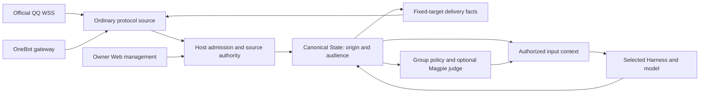

# QQ platform entry — approved design

The user approved implementation2026-11-13. [PRD Q1–16](prd.md) owns product decisions. Proposed names below become implemented APIs only when the corresponding code lands. The independent technical review closed its three blocking findings before approval; the task is now in_progress. [Planning progress](progress.md) records the review and verification scope.

## 1. Owners and the smallest coherent increment

Keep the existing canonical Agent ID/persona, State provider, Config/CAS, PluginManager, TaskSupervisor, PermissionKernel, CredentialBroker, selected Harness and independent work map. Add two ordinary protocol sources and the minimum runtime contracts required by multiple real participants. A platform/QQ account/group/gateway session is never another Agent identity.

| Owner | Responsibility |
| --- | --- |
| Official QQ source | Its account/config/credential binding; outbound official WSS; protocol decode; fixed official HTTP upload/send; actual connection cleanup |
| OneBot source | Its exact gateway/account binding; authenticated OneBot v11 transport; explicitly selected media-extension profile; actual connection cleanup |
| Existing runtime + narrow QQ host ports | Source admission, host-derived principal/audience/grant, normalization validation, model-input dispatch, visibility and work authorization |
| Existing State provider | Canonical provenance/full origins, input states, task/material audience, scoped facts and finite delivery attempt/part facts |
| Existing model binding machinery | Primary conversation plus a separate `qq-participation` purpose/binding; no temporary primary-model switch |
| Supervised media operations | Owned bounded download/staging/decode/encode/upload with current material authority; no public arbitrary URL/file reader |
| Web management | Service-owned settings, source controls, people/groups/policies/media/model views and actual receipts |
| Desktop | Read-only bounded source status and open-Web action; existing personal chat/Pet continue in the owner-private audience |

Proposed ordinary packages are `shared-qq` (feature/policy configuration and host registration), `qq-official`, `qq-onebot`, `qq-participation-magpie` (a separate binding reusing the existing Magpie connection factory) and `qq-media-codec`. These are purpose-specific sources under the existing manager, not five new managers. Config remains ConfigService-owned; canonical principal/audience/origin/material/effect facts remain State-owned. Existing accepted delegation is independent of the live QQ connection: transport disable is not participant-policy revocation.

No generic plugin network API, second bot runtime, per-platform memory database, universal scheduler, plugin market or QQ login implementation is added.

## 2. Stable identities and authority

The host derives these facts from an authenticated source and owner-managed policy. No model/tool/QQ payload can supply a trusted role, scope or arbitrary reply address.

- **Source account:** protocol plugin/default instance plus logical account identity. Live authority additionally captures source generation/digest, Config revision, policy epoch, credential version and unique connection ID.
- **External actor key:** protocol/account/scene/sender namespace. QQ official opaque IDs and OneBot numeric IDs stay distinct. Display names, quoted actors, timestamps and similar text never establish identity.
- **Principal:** stable product identity mapped explicitly from external actor keys. Existing desktop/Web operator is the owner principal. Alias changes are an explicit management operation, not automatic account matching; no silent reassignment of old history/work.
- **Audience:** owner-private, another private-person scope, a protocol/account/group scope, or explicitly public facts. Group context is not an administrator context even when the current sender has administrative actions.
- **Input:** canonical input/message/evidence IDs, principal, audience, fixed logical reply route, trigger kind, captured policy and preparation/processing facts. The complete origin set survives publication and task creation.
- **Reply route:** logical source/account/scene/target plus original message/event/display-reference facts. It contains no secret and is separate from a live socket/token/session.
- **Action grant:** host-private authority for one active input/context, checked against current policy at reads/effects and after awaits. Durable metadata is an audit fact, not a reusable lease.

Administrative policy and source configuration use existing Config/CAS with bounded schemas. Canonical origin/material/task/delivery records use State transactions. Do not keep two writable copies of the same policy or message history.

Empty private/group allowlists admit nobody. Selected groups admit ordinary members; QQ group rank alone grants no Agent administration. Member actions are intersected with both source capability policy and the captured/current participant grant. A later role promotion cannot elevate an old accepted member input; downgrade/revoke fences affected live authority.

## 3. Context, memory and work

Before a model request, select authorized records **before** pagination/truncation. The projection includes shared persona, current input, visible scoped/public facts, bounded permitted history, visible work and authorized material refs. It never includes signed URLs, credentials or another audience's private tails.

One active instruction authority must be unambiguous. Different principals, audiences, grants or reply routes cannot be merged into a tool-authorizing batch. Historical group messages may have many authors; they remain evidence, not current commands.

Cortico's `reloadSystemPrefix` retains old user/assistant/tool tail; `clearSession` waits a batch and retains its event store. Neither establishes privacy isolation. The selected design keeps bounded **input-owned active execution contexts**, not per-person/platform idle brains. Each has an independent projection directory, Core/Session log, ports and grant. The canonical Agent/persona/State remain singular.

Start with2 active contexts (hard cap4), bounded ready admissions and **one FIFO native-model dispatch permit** for primary interaction. Acquire that permit before entering native model/credential borrowing. At the next `respond` boundary, a waiting input may proceed while the previous context is parked with its original tool calls/receipts/tail intact. Permit cancellation removes the waiter; release follows actual native settlement. Capacity overflow is visible bounded waiting/rejection, not a promise of unlimited immediate handling. Multiple independent `start_work` effects remain legal; there is no artificial one-task-per-input cap.

A parked context is not retired/replanned. It keeps only its own immutable principal/audience/route/grant; other people's messages in authorized history remain evidence. Refresh visible canonical context at a permitted boundary without replacing scope or treating history as new instructions. No input is steered into another sender's context. A unique projection namespace is used for provider session/cache metadata; such metadata grants no authority.

Natural terminal completion or forced invalidation retires the context outside its own hooks. Abort permit waits, join actual native calls/tools/world shutdown and inspect stop failures; Cortico's bounded `stop()` return alone is not proof of drain. Do not use `spawnFork` as an unverified cancellation substitute. A cleanup failure keeps its resources/slot unavailable. Crash/forced interruption with committed effects records interrupted/unknown input state; it is not automatically re-run with freshly generated effect IDs.

The existing single-current Harness/status/projection-applied ports require targeted input/projection scoping and aggregate status. An applied acknowledgement names an actually installed projection and revision; do not promote a saved revision or another audience's acknowledgement into universal applied state. Register/import the source loader once, and await its asynchronous unregister only after all owned contexts drain.

Grant classes:

| Input kind | Allowed behavior |
| --- | --- |
| Direct admitted member | Reply; read current permitted materials; start restricted work; read/list/stop own work only when its data is visible here |
| Owner/explicit administrator | Authorized conversation work and explicit fact mutation; global management remains a private management operation, not automatic disclosure into a group |
| Proactive group input | Reply-only using allowed group/public context; no inherited sender/admin/tool/fact grant |
| Work-result input | Read the exact task/result/materials needed for its original audience and reply; no new task creation or unrelated mutation |

All long-term fact mutations remain owner/admin-only, including person-private facts. Preserve explicit memory cue/verbatim evidence and CAS behavior. Public publication is an explicit management operation with scope preview, not a model-selected visibility flag. Ordinary chat observation does not create facts. Removing an active fact does not erase historical transcripts or already delivered platform messages.

Persist the initiating input/principal/audience/logical route and material refs when work is accepted. Existing independent workers outlive a QQ connection. Task IDs alone authorize nothing: reads, stop and exports check ownership/action grant and audience separately. Worker input mounts contain only admitted materials; no host filesystem/network/secret access is gained from QQ text or a file name.

The ordinary desktop/Web conversation is owner-private. Other people's/group replies remain available in authorized management views but do not automatically become the owner's personal model context, Pet bubble/caption or speech feed. Explicit mapping can connect the owner's QQ private identity to that same owner-private relationship.

This is enforced twice for automatic speech: Main checks the canonical message's audience/surface eligibility **before FIFO admission**, and the service rechecks the authorized consumer purpose and exact canonical content **before synthesis**. The QQ media consumer has its own authorized route/purpose; it never impersonates Pet readiness or obtains a generic all-message synthesis right. Legacy owner messages retain M5 opt-in behavior after migration. Viewing another audience in an admin screen does not change the personal chat/automatic-playback binding. QQ's optional voice setting controls QQ media; it does not toggle an independently enabled owner's private Pet playback.

## 4. Input and State changes

Proposed State format3 adds only necessary facts to the existing SQLite writer:

- Immutable message provenance and media references, with full origin references in addition to preserved legacy `inputId` semantics.
- Bounded `input_admissions` states such as preparing/ready/active/completed/cancelled/failed/unknown; group context-only observations do not become actionable admissions automatically.
- Scoped fact identity and visibility; existing global monotonic set revision + row CAS can remain initially.
- Task origin and material access metadata.
- Owned media metadata and finite `qq_deliveries`/part attempt facts.

No network, decoder, model or upload operation runs inside SQL transactions. In-memory collections hold current handles, not a second durable queue/history. Persist admission/effect intent before dispatch; preserve the old same-command fingerprint/duplicate behavior. Unknown interrupted inference/effect states are not automatically executed again.

Official message IDs and OneBot event/notice identities need protocol-specific stable normalization. A missing unique event identity is not repaired by fuzzy text/time dedup. Normal message versus file-upload notice aliases are merged only when actual fields establish their identity. Self/system/known-machine echoes are excluded before context and judge admission.

Old format2 data uses an explicit stopped/offline full-root backup and version3 transaction. Preserve Agent/epoch/message/task/execution/artifact/command IDs, timestamps, fingerprints and receipts; old facts/history/work become owner-private, ambiguous origins remain legacy-unknown. No migration creates QQ deliveries or replays historical effects. Original4120 data is not migrated as part of unapproved development testing.

## 5. Protocol sources and live lifetime

Both sources are ordinary removable modules with one default account binding each. They can be enabled independently. Multi-instance same-protocol accounts, automatic physical-group aliasing and a second QQ client/login runtime are outside this increment.

Official source uses current official gateway/token/HTTP endpoints, not historical SDK domains copied blindly. It handles Hello/Identify/READY, subscribed message intents, heartbeat acknowledgement, bounded connection recovery and documented Resume replay. A socket opening is not authenticated readiness. Persisted normalized event identity prevents repeated Core admission when upstream replays.

OneBot initially targets a clearly configured authenticated v11 connection and explicit SnowLuma compatibility operations. Universal versus split connection handling must be declared by that compatibility profile. Verify account identity and response/echo on the captured connection. No SDK local action catalog is called a server-capability check. A disconnected pending action is unknown where it could have executed; it is never transparently replayed.

Source activation registers/binds ports; connection work requiring active-source authority begins after PluginManager active state. Native ports expose only the fixed operation set/destinations for this source, not raw runtime/operator bearer/generic sockets. Source/key/config/policy changes fence old callbacks before fallible cleanup. Await actual socket/HTTP/codec/credential work; unconfirmed cleanup blocks replacement.

Network recovery while the source remains desired-enabled is distinct from explicit disable/removal. Explicit disable stops ingress and unattempted outgoing parts; already accepted service work remains canonical. Re-enabling does not sweep old global assistant history into QQ. Recovery may process only proven unattempted retained intents whose original logical target and current authorization still match; confirmed/unknown attempts are never repeated automatically.

Secrets use independent target/account-bound broker slots, captured version CAS and existing private ingress. No primary-model/ASR/TTS/AstrBot/DSH key is borrowed. The existing loopback-only key-writing predicate remains visible: remote Web can edit ordinary settings, but key forms truthfully report non-writable unless reached through the permitted private management entry. Persistent deployment secrets must be supplied explicitly through the approved host mechanism; process memory is not advertised as restart-safe secret storage.

## 6. Bounded media and mandatory text

Binary bytes never go into canonical JSON/SSE/ordinary IPC. Canonical references record origin/audience/verified size/MIME/hash and a protected storage locator. Private signed references and upload tokens stay out of prompts, logs and public views.

| Content | Required path |
| --- | --- |
| Text | Complete canonical text and ordered formal replies; exact current route and platform attempt accounting |
| Image input | Bounded authorized download/format validation → canonical ref → per-request scoped resolver/native image part for a compatible selected model |
| Voice input | Authorized recording bytes → actual decode/resample → correctly scoped ASR; complete ordered transcript and original media provenance; no renamed raw bytes or silent truncation |
| File input | Authorized bounded staging → material refs → only assigned worker input namespace; files are not automatically executed |
| Image/file output | Authorized current-audience artifact → appropriate actual upload/send API; upload and send effects recorded separately |
| Optional voice output | Canonical reply → separate QQ TTS intent → consume real PCM stream → real supported container/encoding → bound upload/send; required text remains even when voice fails |

M4 capture remains16kHz mono f32le with20-second clips. M5 remains24kHz mono PCM16 streaming and independent Pet opt-in. A longer QQ recording uses a new bounded attachment path: decode completely, validate real duration/frame counts, split into at most6 exact non-overlapping20-second PCM spans, transcribe each under the existing ASR authority, then commit one ordered complete transcript/input. Any missing/failed span prevents a complete-transcript claim or partial automatic command execution; original material and failure facts remain accessible. M4 itself is not claimed to support120-second capture.

The selected built-in codec path is a purpose-specific, supervised **Docker codec job**, reusing the existing owned-container/process/task primitives without creating a user-visible coding task or a generic sandbox manager. Its versioned image contains fixed FFmpeg decode/resample commands and pinned `silk-wasm3.7.1` encode/decode. Inputs/runtime artifacts are read-only, output is an owned temporary directory, network is disabled, memory/CPU/process/output limits are real container limits, and cancellation awaits actual container/process settlement. There is no ambient host PATH execution or fallback. The image digest, FFmpeg build, embedded codec licenses and dependency hashes are established at the dependency gate; until that gate passes, availability is not fabricated. [Codec evidence](research/codec-options.md) records the exact package/API and why its growing WASM memory cannot be treated as a bounded in-process decoder.

Decode approved WAV/SILK and explicitly supported FFmpeg audio formats to mono16k PCM; convert exact PCM16 samples to the M4 f32 transport without altering capture budgets. Encode completed optional QQ audio as actual Tencent-compatible SILK, with content validation after encoding. Bound QQ attachment voice handling to120 seconds; this is an application budget, not a claimed QQ universal voice-duration limit. Exceeding it preserves mandatory text and records audio not completed, never a silently shortened successful voice.

QQ output never fakes a Pet AudioContext-ready acknowledgement. A real media export consumer is prepared before native synthesis. Codec availability is a real capability, not a file extension.

OneBot server paths are remote references, not local files. Prefer verified bounded byte-transfer/material APIs when machines differ. Every material read/export rechecks current authority; knowledge of an ID/path is not access. Temporary stage/codec files are owned and cleaned exactly, with remote retention/cleanup reported only when proved.

Official file type4 is supported in current documentation; upload thresholds/soft presentation limits and format inconsistencies stay in [protocol evidence](research/qq-media.md). Set explicit no-send upload semantics when using a separate send, and never attach bot bearer to presigned storage URLs. OneBot file extensions and their side effects must be verified for the selected implementation/profile; a file ID or remote stage path is not fabricated as a chat message ID.

Text is always present; voice defaults off and can be enabled as an addition. Remove the current ordinary-model `.slice(0,8000)` publication path: no shortened text is accepted as a complete model reply. Existing inline canonical text bounds remain; a larger completed body within a new explicit64KiB UTF-8 full-result budget is stored as an audience-bound full-text material with exact hash. Its canonical representation explicitly says `text-document` and contains a fixed visible explanation plus the full-text reference, not a fake complete preview. Above the full-result budget, fail publication truthfully rather than silently cutting it.

A canonical content reader resolves that semantic full text under authority. Context projections may omit with markers; delivery may not summarize it. Speech consumers must not read the explanatory stub and claim the original was spoken. If the complete semantic text exceeds their declared synthesis budget, report voice unavailable/failed while the complete text document remains available; M4/M5 capture/playback budgets are not silently expanded.

For QQ, the default **application** inline-part budget is1024 UTF-16 units with valid Unicode/CRLF boundaries, at most2 complete inline text parts per batch. This is not a claim about the platform's maximum. Larger complete text uses a short explicit text notice plus one UTF-8 file. Freeze the representation and exact byte hashes before sending. Source-specific refusal remains a real failure, never proof that an undocumented platform limit is larger.

Voice/media failure cannot remove already accepted text. Unknown/partial batches are not resent wholesale or switched to another protocol/account.

## 7. Delivery facts and work completion

A committed assistant message is an output intent, not a send receipt. Proposed delivery records bind canonical output/full origins, logical source/account/audience/target, format and part order, source content hash, original reply/reference basis, attempt ID, actual returned IDs and bounded errors. Claim an attempt durably before network I/O.

Keep facts distinct: prepared, upload attempted/accepted, send attempted, platform accepted/rejected, partial, cancelled-before-send and unknown. Do not claim human receipt/read/playback. Official `msg_seq` and OneBot `echo` have their actual protocol meanings; neither is a universal exactly-once guarantee.

Multiple formal `say` outputs remain separate ordered canonical records. The QQ sender closes a delivery batch at the corresponding input context's natural terminal boundary (or records a truthful partial/error batch on failure), rather than spending the passive allowance on an unknowable future sequence of `say` calls. This does not wait for detached background work to finish. Ordered bodies are retained exactly in the frozen text representation; grouped text files do not erase the underlying canonical messages.

Before the first send, allocate stable part IDs/`msg_seq` where applicable and freeze: complete mandatory text representation, required requested media, optional voice, target/reference, chosen passive/proactive eligibility and remaining allowance. Count every actual native message part. Prefer the text-notice+complete-file representation when inline parts cannot fit. If mandatory content cannot fit the currently permitted mode, do not start an inevitably incomplete batch; retain a blocked-delivery fact. Do not probe by sending a prefix and guessing the rest.

**Gate:** every mandatory text part must obtain a conclusive platform-acceptance result before optional voice synthesis/upload/send starts. A rejected, failed or unknown mandatory text part stops all remaining unattempted parts; an unknown attempted part is never resent. Required media is then sent in the declared order. Any later failure preserves previous facts and prevents blind whole-batch replay. Optional voice rejected by eligibility/quota or failing generation/upload/send leaves text intact and voice explicitly not completed. Lack of optional allowance is determined before sending, not hidden as successful audio.

A delayed work result uses its original task actor/audience/logical route, never the latest chat. Recheck current sender permission and actual passive/proactive platform eligibility. Use conservative documented passive budgets (C2C4 attempts with the shorter conflicting5-minute eligibility, group5/5 minutes) as compatibility policy, not a claim that C2C's documented60-minute option is false. App-level proactive chat and the platform's wire-level proactive send mode are separate. Choose a permitted wire mode before dispatch; a failed/expired passive send does not authorize silently removing its reference and retrying as proactive.

Known success is not resent. An attempted send without conclusive evidence remains unknown after cancellation/crash/reconnect. Manual recovery is an explicit previewed new action where appropriate, not changing an ID to hide the uncertainty. Completed work remains completed even if its QQ delivery is unavailable.

## 8. Recent group context and participation

Only selected groups enter bounded context. Ordinary observations do not create a task or fact-write admission. Explicit @ events and configured literal wake words create direct inputs under the actual sender grant. Do not require a literal @ token when the official event type already proves a bot mention and the platform removed the prefix.

Optional proactive participation starts only after configuration enables it. Both rule/probability mode and rule-gated model judgment are supplied. They share source/allowlist/self-echo checks, per-group cooldown/frequency and global model/concurrency budgets. A late decision after config/role/route withdrawal cannot send.

The model judge uses an independent `qq-participation` purpose and explicit Magpie source/model/credential binding. Reuse the existing ModelConnections/source factory and add purpose-specific resolution, with a separately registered ordinary Magpie judgment source/config/credential lifetime. Do not put both roles into one reload-coupled configuration or temporarily change the foreground selection; do not create a second model registry or Agent. The primary model's per-request image resolver is a separately scoped extension of its actual native factory.

The judge is tool-free, reads only allowed bounded group/public text and media metadata, and returns a constrained participate/decline result. It creates no canonical assistant reply. Admission reserves one durable judgment-attempt ID/budget unit before native I/O; repeated event IDs do not create another attempt. Use one native attempt with captured policy/source/target and no hidden SDK retry. A failed reserved attempt still counts toward the documented attempt budget; token usage is reported only when actually returned. Primary model selection/context/work are not retired when judge settings change. Error, timeout or budget exhaustion produces no proactive reply and no silent mode/model fallback; explicit wake inputs remain eligible.

The judge's positive result admits a reply-only input. It does not inherit the most recent member/admin's permissions. Attempts and actual usage remain separate; unavailable usage is not zero cost. Native retry behavior must be explicitly bounded rather than assuming `role` metadata disables retries.

## 9. Settings and presentation

Web gets one QQ management entry using existing ui-kit/dialog/list/field/status patterns. The platform group contains two independently controlled protocol cards; the rest separates connection/credentials, allowlists/principal mappings, global/per-group participation, judge model/budget, media/text-plus-voice, scoped-memory administration and delivery diagnostics.

Config uses the correct captured source/target/expected revision and independent credential version. Settings save performs no model inference or real test send. Show actual saved/applied/connected/provider-accepted/failed/unknown states. Do not call a saved credential, an open socket, an upload token or an empty response “verified delivery”. Lists are bounded/paged; retain existing64KiB JSON and snapshot aggregation budgets.

Desktop consumes a small service-owned status projection and opens the current configured service Web origin. It never places the operator bearer in navigation URLs and does not become another QQ configuration owner. Normal personal chat/Pet scope remains separate from an administrator viewing another audience.

## 10. Candidate application budgets

These are product resource recommendations, not platform maxima. Final declarations must be centralized in source and exercised at boundaries. Config limits remain the existing48KiB schema-backed record; JSON/media/kernel boundaries are not expanded merely to fit a native packet.

- Context: latest30 group messages or30 minutes, at most12KiB rendered context with omission markers.
- Admission:2 active input contexts by default, hard cap4;16 ready inputs globally and4 per audience, with one primary-model dispatch permit. Queue/capacity states are visible. No native model task is consumed for every queued/context-only event.
- Allowlists: up to128 private entries and32 group entries per source, with final encoded Config as the governing bound.
- Facts: retain the existing32-active-fact/8KiB content bound initially across scopes, with truthful management usage; never evict private facts to admit group data.
- Proactive default: disabled; when enabled, start with60s/group cooldown and6 logical proactive replies/hour/group, independently configurable beneath hard resource caps.
- Judge default: one concurrent judgment, at most1/minute/group and30 admitted attempts/hour globally;10s operation deadline and256 output tokens. Primary generation is independent.
- Media proposal:4 parts/input,8MiB/image,32MiB/file and32MiB aggregate/input;2 preparation operations and128MiB active staging. These are not promises of QQ media-card presentation at those sizes.
- Voice proposal: at most120s input via at most6 existing20s recognition segments, with an8,000-unit complete transcript bound. This is new attachment work, not a claim that current M4 already handles120s.
- Worker outputs keep current1MiB default/8MiB aggregate maximum unless a separately reviewed execution change is needed; transferred input material and output budgets are distinct.
- Outgoing parts are ordered per target, with bounded active uploads. Platform counts include every actual message part; no unlimited retry queue.

## 11. Verification and rollback

The [protocol test matrix](research/protocol-test-plan.md) separates static/source, controlled sockets/models, production UI and explicitly authorized real-platform evidence. Official private/group and OneBot private/group each need the selected media paths; one successful cell does not establish the others.

Require cross-principal context canaries before/after native tool tails, own-task/material negative cases, ordinary-member fact denial, config/role downgrade during awaits, duplicate/changed input, partial/unknown sends, true source removal/drain, judge/primary isolation, media format/resource failures, Web CAS/draft/target behavior and unchanged existing owner flows. Multi-step/multiple-work behavior must not be silently reduced to make isolation tests pass.

Migration tests verify cold backup/lock/transaction/identity/receipts and no historical delivery replay. Real data migration and any account/model/send check wait for explicit scope authorization. Rollback uses the stopped full-root checkpoint, not the old writer against format3.

## 12. Review and implementation gates

The selected dispatch is bounded active-input contexts with a single primary-model permit; it retains tool receipts rather than destroying/replanning at ordinary yield. Main and service both enforce owner-private Pet eligibility. Delivery representation/attempt order and mandatory-text-before-voice gates are fixed above. OneBot compatibility treats upload/send side effects according to inspected handlers, not SDK names: SnowLuma private upload defaults to a send effect, and group file publication is not followed by a guessed duplicate send. Installed-version behavior still requires the explicit matrix.

Phase0 must prove the actual scoped Harness/status/media factory seams and dependency/resource behavior before wiring live transports. In particular: retained-context cancellation/permit wakeup, no credential borrow while parked, multiple legitimate work effects, codec-container resource/drain behavior, real image resolution, and exact State/public boundary budgets. A failed gate is not permission for a stub, a scope reduction or an arbitrary host fallback.

The ordered implementation plan and both19-entry context manifests are complete and validated. The independent reviewer closed the identified design gaps on2026-11-13; no substantive planning blocker remains. Real account endpoints/version, platform permissions and any paid-model/send trials remain later explicit integration material, with no current authorization.

This design is not execution evidence. The user subsequently approved the complete planning summary and task activation succeeded2026-11-13. Phase gates and actual test results are tracked in progress and evidence records.
