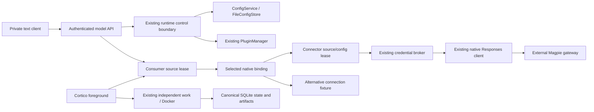

# Model-backed text companion — design

Status: converged design for the owner's approved continuation, 2026-11-08. This document authorizes no secret reuse or live inference and reports no new implemented behavior. Exact interfaces are maintained once in [implementation-contract.md](implementation-contract.md); execution/ownership is in [implement.md](implement.md). The [PRD](prd.md) remains the requirement source and [research](research/model-configuration.md) records source evidence and rejected boundaries.

## Decision and outcome

Ship an ordinary replaceable **model-connection plugin**, defaulting to `pet.model-connection-magpie/magpie`. Model endpoint/model/auth settings belong to that plugin's Config. Cortico owns the foreground inference loop and consumes an immutable native client/model binding; the continuing identity, explicit facts, receipts and work remain in the existing companion runtime/state authority. A small deterministic connection fixture proves replacement while the same Cortico Harness remains selected.

The owner sees one compact settings surface: choose the connection/mode, edit its nonsecret fields, optionally enter an independent gateway key, **保存并应用**, then explicitly **测试连接**. Saving changes the active binding at a safe boundary and does no inference. Test observes the exact applied binding and does not save local edits or enable model mode. Enabling is part of the save/apply mode selection; it has no separate draft/candidate service. A model failure never silently changes to scripts.

The Magpie adapter connects to an already-running explicit HTTP/SSE gateway. It does not embed Magpie as an npm library, bundle/start its Go process, import accounts, alter agent files, call an Admin API or manage Magpie routing. Default loopback API base: `http://127.0.0.1:3425/v1`. Empty model is unconfigured; a suggested URL is not a discovered or tested service. Remote/shared gateway auth uses an independently supplied gateway key; upstream provider credentials remain in Magpie. Managed-gateway packaging, voice and other modalities are outside this stage.

## Existing foundations and change boundary

The implemented [service assembly](../../../../../apps/companion-service/src/service.ts#L149) closes over launch-time model fields and supplies an authorized client directly to Cortico. The [native model transport](../../../../../apps/companion-service/src/model-client.ts#L62), [source helper](../../../../../packages/companion-runtime/src/source-authority.ts#L13), CredentialBroker and TaskSupervisor already preserve original native errors/private values and await physical settlement. Keep those mechanisms and change their source attribution from Cortico credential ownership to connector ownership.

The [ConfigService](../../../../../packages/host-kernel/src/config/service.ts#L172) and FileConfigStore remain the only settings writer. The [runtime lifecycle](../../../../../packages/companion-runtime/src/runtime.ts#L649) remains the only control boundary. A new task manager, model gateway, scheduler, database settings table or credential cipher would duplicate an existing owner and is rejected. The generic SDK's capability methods carry JSON; native callbacks/options/results/errors therefore stay on a factory-bound host-private facet, following the existing bound Cortico factory pattern rather than changing SDK transport semantics.

The desktop [llm-provider](../../../../../plugins/llm-provider/plugin.json#L1) and its connection controller are useful interaction/probe precedents, not portable headless adapters: its platform/network/media/SDK credential assumptions and JSON result roundtrip differ. Do not mount its broad catalogue or copy DSH/desktop profiles. Use actual node:sqlite state and schema/Config contracts; generic Drizzle/Zod templates do not describe this application.

## Components and data flow

One activation-owned binding map associates a manifest-declared provider with its owner generation, Config revision, model and native client. It is not another plugin manager: PluginManager still installs/activates/disposes, ConfigService owns revisions, TaskSupervisor owns all calls, and the permission kernel owns leases. The generic binding/transport/ports declarations are frozen in [the native contract](implementation-contract.md#2-host-only-native-port).

A connector is a normal `PluginDefinition` created with documented host-private ports. Its control capability `companion.model.connection@1` publishes only safe `describe` metadata. Its native facet preserves the current `ResponseClient.respond(request, options)` protocol and opaque result/error objects. A custom plugin can be supplied through existing programmatic service registrations; a marketplace/upload/install UI is not required to demonstrate replaceability. No Magpie switch/case belongs in Cortico.

## Two-sided authority and lifetime

A regular model reply is rooted in the current Harness source task plus its `capability-use` lease. An explicit owner check uses the protected companion-host's corresponding lease, independently of Cortico readiness. The native dispatcher also holds the selected connector's own config-read source lease, so a credential-free fixture still responds to source deny/revoke/fingerprint changes. The default transport adds the actual connector-owned credential lease. Both owners, current selection, revision and all abort signals remain relevant until physical work settles.

Move the obsolete Cortico credential declaration/support to the Magpie connector; retain Cortico's state/execution permissions and add optional model-connection consumption. JSON `describe.methodPermissions` cannot authorize the native private call; that call explicitly obtains its own source permissions. An active owner, an allow preset or a host-provisioned credential seam alone is not a substitute for source leases. The [existing permission adapter](../../../../../packages/host-kernel/src/permissions/adapters.ts#L7) and helper are reused; the lower-level kernel is not redesigned.

The native path forwards options by spread and replaces only the required combined signal/redactor event wrapper. It preserves original safe GenerationError/partial/attempts/origin and private values outside supervisor JSON. Late callbacks cannot publish to a new generation. Logical cancellation does not prove socket, broker or Core cleanup; retain actual work and `settled`. A noncooperative disposer yields unavailable/pending_restart and prohibits replacement. A request cancellation/timeout or one consumer's loss of authority does not retire a valid shared connector; suppress that request's late events while other legitimate consumers continue. Explicit revoke aborts live leases immediately. Disk-source changes are checked at admission, event callback and return boundaries; there is no fswatch and a silent in-flight operation using loaded trusted code is not promised instant disk-change cancellation. Current-stage host/SDK ConfigService.save commits notify the exact connector revision before successful save returns, fencing it without polling; actual drain remains independently awaited. Local drain confirms local resources, not termination of remote vendor compute/billing.

## Configuration and credentials

The default plugin has bounded `{baseUrl, model, authMode}` Config with explicit reload application, as specified in [the manifest contract](implementation-contract.md#3-magpie-manifest-and-configuration). The companion-host Config only adds optional model selector/mode; Cortico's existing `{}` remains untouched. Preserve all old schema-version-1 profile content. Resolve omitted new fields explicitly; defaults do not rewrite existing records. Apply only explicitly supplied environment overrides, including independent key injection.

`local-client-id` is legal only for explicitly accepted loopback targets (`localhost`, `127.0.0.1`, `[::1]`). The documented `magpie-dsh-pet` bearer is a public app identity, not a saved upstream secret. Nonloopback targets require HTTPS and the independent `gateway-key` mode. A fixture also requires no secret. This prevents an API-key-only UI or an accidental anonymous remote connection.

For gateway keys reuse host-only `suppliedSecret`: explicit environment/secret-manager provisioning or dedicated browser submission held in memory. The Linux service has no accepted persistent cipher; do not build a plaintext fallback or read Magpie/DSH account files. This HTTP implementation accepts browser key entry only with an actual loopback peer/Host and absent-or-loopback Origin (owner-controlled local/SSH access). A remote HTTPS publicOrigin or local forwarding proxy cannot prove TLS-only ingress, so remote key writes remain false/403 and use independent host injection. Explicit TLS-termination integration is outside this stage. Keep the key out of Config, command payload hashes, public DTOs/events, logs, projections, artifacts, URLs and browser storage. The key is never model prompt input.

Credential slots are bound to connector identity and the full normalized API base URL/auth mode. A path change on the same origin still invalidates old-key availability. No secret carries to another connector/endpoint without a fresh explicit supply. After the new selection CAS commits, clear/rotate the predecessor slot and fence its binding before fallible cleanup; physical drain still completes before replacement. A rejected CAS leaves its healthy key intact, and same-ID recovery after partial application cannot resurrect it. An opaque credential version contains a fresh process generation plus slot generation; restart cannot accidentally match an old form expecting zero. Even missing/no-secret slots have process-scoped versions. Key-only change invalidates verification without pretending the Config revision changed.

## Truthful view and concise interaction

The canonical nonsecret view in [the DTO contract](implementation-contract.md#4-browser-safe-dtos-backend-owned-shared-source) distinguishes:

- Desired connector/service mode and the target plugin's saved Config revision.
- Actual applied native binding and whether the model-mode foreground is enabled.
- Whether auth is required/available, how it was supplied and the opaque CAS version.
- An exact-binding explicit check: unconfigured, configured, validating, verified or failed, with timestamps, fixed error and network/synthetic evidence.

These are separate facts. Saved settings, mounted plugin, available key and Core ready do not establish a successful inference check. A scripted foreground may explicitly test a configured connector without silently enabling it. A synthetic fixture success must say it did not connect a real model. Restart/source changes reset the process-local check. Old check completions cannot verify a replacement, and a normal later chat is not fabricated as an explicit check result.

The frontend edits only the fixed Responses fields and explicit mode/selection, using the one shared view; null settings mean no generic form for that programmatically configured connector. It does not host arbitrary plugin Config/Admin CRUD. A remote-key submission may be the second request within one save action: first apply nonsecret settings, then private key CAS using the returned target/version. Key-only changes use only the latter. Test stays disabled for unsaved form changes, unavailable target/auth, an active check or offline state. No automatic tests on save/load/reconnect.

## Save, switch and check sequence

1. Validate service auth/origin, exact input, target/auth semantics and both profile/plugin CAS revisions. Use the existing runtime control state to reject a busy foreground/control/check before changing anything. Independent work alone does not block a switch.
2. Record the nonsecret intent and save desired Config/selector/mode through their existing CAS owners. These are separate records, not an atomic cross-store transaction. A partial saved/unapplied result is visible and retry converges only its unchanged target; do not invent rollback or overwrite a superseding edit.
3. Quiesce foreground admission; retire/disable Cortico and await real in-flight work. Disable/unbind/drain the old connector and broker. No replacement after unknown cleanup/pending_restart. Saving the same selected connector with changed settings still needs an actual reload: [enable(active)](../../../../../packages/host-kernel/src/runtime/plugin-manager.ts#L253) is a no-op.
4. Enable the selected connector from saved Config, register its current native facet and rebuild the foreground with the same identity/persona plus the new client/model (or intentional scripted mode). Verify actual lifecycle states before publishing applied/enabled. Incomplete config/key leaves settings accessible and model unavailable. No automatic fallback.
5. Keep state/execution plugins, work handles and all task/execution/artifact/receipt identities untouched. Withhold optional result delivery during quiescing; [recordOutcome](../../../../../packages/companion-runtime/src/runtime.ts#L480) already commits physical result and notice before projection. A completion racing reload must not deliver to an old accept handler or make the replacement unavailable; canonical results remain authoritative and are read by the new context without replaying effects.
6. Explicit test records a durable nonsecret intent, captures the applied binding and returns 202. It uses the existing tracked source task with a 15-second diagnostic Responses SSE request, no history/tools and 256 output-token cap. Same-ID retry never resends, even after restart; unknown old result requires a fresh user action. Complete the check only after actual settlement and unchanged authority/binding.

One client diagnostic request disables only Cortico's native retry delays. Magpie routing groups, classifiers and account failover can generate additional upstream calls. Live acceptance must name the concrete route and known policy; no claim of exactly one vendor billable call follows from one client HTTP request. `/api/hello`, model listing and port connectivity are not inference verification.

## Validation, rollout and pending external evidence

Use focused tests for two-sided source authority, opaque native values/options/errors, actual sockets/drain, current binding/version invalidation, duplicate check no resend, endpoint-bound key isolation, same-Cortico connector replacement and work-completion races. Keep the existing foundation/real Docker/browser/full root gates; the [implementation plan](implement.md#validation-and-acceptance) maps exact stages and evidence.

A practical owner-approved run asks the model to produce Markdown/CSV from a tiny expense list with a checkable total, verifies actual start_work admission and exact authenticated file bytes, continues chat during work and stops only one task. Switch to the labeled connection fixture and back at an idle foreground boundary while the other job and Agent identity/fact/artifact IDs persist. Fixture/loopback success is recorded separately from real Magpie/upstream operation. Without the owner's gateway/model/credential, real-provider acceptance remains **pending**; no synthetic pass fills that box.

The owner explicitly stopped the trial at http://10.1.0.7:4120; the retained stable runtime worktree/profile is prepared. Do not restart the trial as a side effect of development or edit/build inside any live fingerprinted runtime. Develop/test with isolated profiles, preserve the original data/token and record each verified stage in Trellis. Roll back failed new work by correcting/selecting an explicit connection after confirmed drain; retain canonical data and never delete the original profile to get a clean result.
