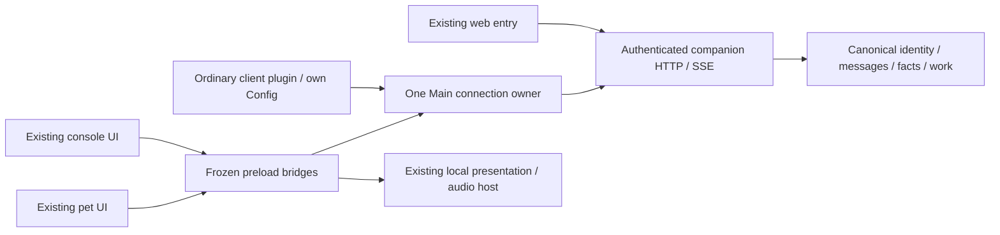

# Shared desktop Agent entry: design

Status: implementation design for the already authorized second stage, 2026-11-08. The [PRD](prd.md) owns requirements. Exact new DTO/IPC/host-private signatures belong only to [implementation-contract](implementation-contract.md); [implement](implement.md) owns execution and evidence. [Source-backed research](../../../11-06-unified-companion-architecture/research/shared-desktop-entry.md) supplies the existing-code and Linux findings.

## Selected shape

One ordinary desktop client source and one Main connection serve the existing pet and console windows. Main makes authenticated HTTP/fetch-SSE requests to the independently running service; renderers consume frozen fixed bridges and retain local composer/form drafts. The service owns persistent Agent identity/persona, messages/facts, work/results and model configuration. DesktopHost continues to own local plugin/runtime permissions, appearance preferences and existing audio/presentation mechanisms. No local Cortico/model fallback or second conversation writer starts in this composition.

Normal desktop startup becomes the shared composition. A disconnected/unconfigured client still opens the local pet and settings where their actual platform permits, with honest unavailable service controls. Closing it drains its own network/media resources and never stops accepted service work. The old executable/revision and preserved data provide rollback; reconnect is not a way to start the old engine.

## Sources and reuse

The [desktop host](../../../../../apps/desktop/src/main/desktop-host.ts#L117) currently spawns a local plugin worker; its RemoteRuntimeDriver is not an HTTP client. Preserve it for local roles, and use a small new Main connection controller. Reuse PluginManager, TaskSupervisor, ConfigService, CredentialBroker, exact file-URL source checks and disposable preload facades. Reuse non-React guards/SSE/HTTP helpers from [text-client](../../../../../plugins/text-client/src/client/protocol.ts) through one narrow export; do not copy wire parsers or import its DOM-owning complete CompanionClient.

The existing pet SVG/composer/bubble/geometry, console shell/theme and speech-output owner remain useful. Frontend integration changes their state/action inputs, not their visual language. Reuse the existing ModelDialog through the controlled model-ui export with structural ModelTransport and only its needed view/live/agent-status facts; no desktop copy of the form. Its extracted model stylesheet is scoped by a wrapper because current ui-kit Dialog has no className prop. Mount/import this UI only in console: ui-kit root theme CSS sets a root background, so the transparent pet must consume only protocol/types/status and open console for model settings. Exact props/ownership/denied credential adapter are maintained in implementation-contract. The [current pet root](../../../../../apps/desktop/src/renderer/pet/App.tsx#L359) and [console root](../../../../../apps/desktop/src/renderer/console/console-app.tsx#L125) unconditionally consume legacy Application/Demo/model hooks; shared rendering must stop mounting those hooks rather than hiding one local chat page.

The service already supplies recent snapshot/events/messages, task detail, task/foreground stop, artifacts and model management. Add only authenticated read-only profile projection for the canonical persona body. Full history pagination/clear, persistent pause, poke receipts, remote setup dialogs, semantic memory and persona writes are absent/deferred; no local Core may impersonate these features.

## One source, exact target and process-lived auth

The new plugin owns its endpoint Config and a declared service-token source permission. Its stateless runtime publishes safe metadata. Main implements the privileged fixed HTTP adapter, rooted in that real source generation, configuration revision and permission leases. Permission admission, lifecycle cleanup and source verification remain in the existing host; no generic transport/plugin framework or wildcard network declaration is introduced. Because the plugin runtime is in a separate process, a narrow host-private RuntimeSession.stop wrapper joins its real Main I/O drain with the existing worker disposer. It preserves PluginManager pending-cleanup behavior instead of treating a changed notification as disposal.

The parent explicitly accepted operator-selected HTTP/HTTPS service roots, including the already named LAN target. This supersedes the research's conservative HTTPS/loopback default: this native owner-input boundary is distinct from model gateway API-key ingress. Normalize one origin, reject URL credentials/query/fragment/non-root path and redirects. Every operation targets a fixed route on that selected service. No new confirmation flow or private-IP literal is necessary.

Connect is a console action: CAS-save nonsecret endpoint, fence/clear predecessor auth after commit, drain old I/O, then establish a fresh connection generation using the explicitly supplied token. Rejected CAS preserves the healthy old connection. No new token persists across process restart or transfers automatically to a new target. Reconnect only retries the current memory binding and reads state; it neither sends messages nor probes a model. The parent will provision isolated Electron45/Xvfb QA tools separately; code must not depend on `require('electron')` auto-downloading anything.

Main owns token text; the renderer sees its own temporary input only until invoking connect. Use existing supplied-secret borrowing and a memory-only broker when OS encrypted storage is unavailable. The source readiness adapter explicitly knows that this host-provisioned credential facility exists even before a token is supplied; source-ready is not service-connected. No gateway Key endpoint is relayed. Desktop model credential projections are nonwritable even if native loopback requests would otherwise appear local to the service.

## Projection, commands and cancellation

One Main snapshot reader plus one SSE reader maintain confirmed state for both windows. Events coalesce refresh; commands return receipts and never overwrite snapshots. Existing protocol/version/receipt guards reject malformed responses before publication. Main-local projection ordering plus the connection UUID protects asynchronous reads/forms across target replacement. Keep profile text in a bounded on-demand read rather than expanding the near-limit snapshot. On profile revision mismatch, refresh and report conflict; never write canonical persona into local preferences.

A send gets a client-generated intent UUID retained with its draft until known admission; a changed intent gets a new UUID. Main owns bounded in-flight/uncertain metadata and validates same-ID payload equality. Same-target retry reuses the exact UUID, then service command deduplication prevents repeat admission. No retry queue, automatic resend or durable client history is added. If network failure loses the outcome, an accepted remote effect remains possible; late replies from retired generations cannot clear a new draft or publish into the new target.

On any failed refresh/ended stream, leave live state immediately, retain last confirmed content/time, and mark nonterminal work/current availability as unknown. SSE has the existing byte-liveness watchdog and bounded cleanup, not idle polling. Device settings/drag/playback stop remain local. Explicit disconnect retains an honestly stale projection but clears auth; explicit new connect clears old target-bound projection/intents after committed selection.

There are separate actions for local playback stop, foreground generation stop and one product task stop. No global pause is invented, and local stop-all is labeled local. Service foreground stop currently has no durable receipt; do not claim same-ID restart-safe cancellation for it. Accepted stop request is not confirmed physical completion. Source/permission/config/connection retirement aborts local requests/readers and awaits actual work plus supervisor settlement, while leaving service work untouched. Unconfirmed local cleanup prevents replacement and is visibly unavailable.

Authenticated downloads stay in Main and the actual native save chooser. Validate current artifact identity, stream a bounded response into an owned temporary file, verify bytes and current binding, then publish to the explicitly chosen destination. A retired chooser/result cannot begin or publish a new download. No arbitrary filesystem path/URL from the renderer, no Blob/token IPC and no artifact URL containing auth. The exact size/deadline/cleanup contract is maintained in implementation-contract.

## Separate local display data from active personality

The [existing profile](../../../../../packages/contracts/src/application.ts#L21) mixes identity/persona, voice and display data. Preserve its record/schema and all excluded values; expose only a fixed presentation/audio subset through a local bridge. CAS merges a validated patch into that same Config owner. Neither an appearance save nor a physical pet reaction calls local Core or posts a service message. Service Agent name/profile revision/persona are separately read through the service bridge.

On supported Windows composition, retain the actual profile/avatar/needed page/speech plugins and current theme/window/audio bridges. Local speech settings and explicit playback/stop remain usable; no new automatic speech delivery is wired to snapshot differences or catch-up. Voice capture/restoration, global keys and remote media policy remain later stages. The shared roots do not mount legacy Demo/model/Application bridges; Main channels that could reactivate their writers are absent/denied.

Shared host admission must enforce the forbidden legacy runtime roles regardless of UI visibility: startup, generic plugin enable/restore, dependency activation, profile runtime commands, guide/page actions and old model/voice routes. Preserve package/config/vault/history files without import. Core PluginManager platform/security checks remain unchanged; the shared host adds its composition policy before activation, and returns a fixed not-ready failure. Unknown user plugins do not get auto-activated. Any explicit third-party activation still obeys current source trust and cannot access undeclared profile/client credentials.

## Honest Linux versus Windows verification

The present host is Linux; existing native probes and many legacy plugin manifests are Windows-only. The current [DesktopHost target](../../../../../apps/desktop/src/main/desktop-host.ts#L173) hardcodes Windows. It cannot be reused unchanged as evidence of legal Linux admission. Do not fake process.platform, rewrite discovered manifests or bypass [core platform compatibility](../../../../../packages/contracts/src/validation/validate.ts#L269).

The minimum Linux QA composition loads only the new client plugin with its real Linux declaration and the **production** shared connection controller, handlers, preload and shared text UI components. Use actual Electron45 Main plus two real file-renderer windows and the existing kernel/SDK/config/task/source mechanisms on linux-x64. Reuse pure PetAvatar/PetComposer/console-shell rendering directly; fixed presentation inputs for unsupported local profile/avatar roles are QA-only and do not claim legacy plugin activation. No renderer bridge mocks establish native acceptance.

Implement a bounded shared-host/platform adapter or direct QA composition using current primitives; do not undertake a general platform port. If the production shared host uses DesktopHost on Linux, it must select the actual known platform, leaving unchanged Windows-only plugins rejected. Support the new text-client composition without force-enabling local TTS, talk-key, SAPI or native ASR dependencies. Windows-specific package integration, legacy-profile preservation under the real shared startup and OS pointer/focus behavior remain separately labeled Windows checks. Linux native Main/HTTP rendering evidence does not certify them.

The parent-owned provisioning/runner must verify the actual binary/display/shared libraries before launch, use an explicit executable rather than a package-entry downloader, forward the required display env, and record actual runtime versions/build hashes. Use isolated loopback service data and a controlled model peer/scripted mode; original4120 stays stopped. Full backend/browser gates and native Linux text tests can run without new real-model calls. A missing Windows runner is a concrete evidence gap to report once, not permission to downgrade Windows regression claims.

## Deliberate limits and remaining engineering checks

No product decision is waiting. Implementation still must resolve actual local file-chooser cancellation behavior, OS binary/shared-library provisioning and Windows runner availability through tests. There is no guarantee a native chooser can be physically dismissed by AbortSignal; fencing its eventual result is mandatory. Persona projection can fail its UTF-8 budget explicitly. Remote stop does not prove vendor execution cancellation. These are measurable limits, not reasons to add fallback engines, auto-migration, new retry machinery or another confirmation stage.
