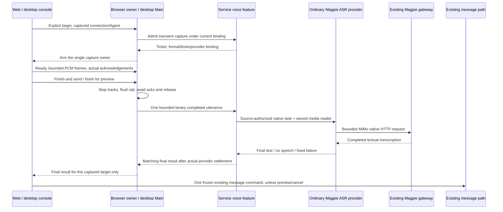

# Shared explicit voice input — design

Status: parent-reviewed implementation design,2026-11-09. The task is authorized to enter implementation; proposed interfaces are not claims of existing behavior or completed checks. No gateway change or live provider/device check is implied. [PRD](prd.md) owns scope. [Implementation contract](implementation-contract.md) is the single owner of proposed DTOs, limits, routes, private ports and lifecycle transitions; [implementation plan](implement.md) owns sequencing and verification.

## Outcome

Web and the desktop console can record one bounded utterance, choose **Finish and send**, transcribe through Magpie and submit one final text command to the continuing Agent. Optional preview lets the owner edit that utterance before sending. Thinking and independent work do not disable recording or get stopped when recording begins.

The service keeps identity, persona, memory, messages and work. Audio preparation is transient; no new conversation database, native Session selector, canonical audio archive or model-facing tool is introduced. This is explicit utterance input, not full duplex. TTS classification helps exclude synthesis models from the ASR picker; there is no synthesis method, player UI or automatic speech in this increment.

## Evidence that changes the design

The source and observation record is maintained once in [parent voice research](../../../11-06-unified-companion-architecture/research/voice-entry.md). The latest parent observation takes precedence over the earlier generic-list inference: an independent UA with `GET /v1/models?kind=all` received nineteen rows, including three real MiMo audio references. The untyped ASR row is recognized by the reference's bounded ASR name rule; the AstrBot-specific response adds some role labels but is unnecessary for finding these candidates.

Use this project's own identity and its configured gateway credential scope. No AstrBot User-Agent, discovery switch, configuration import, new gateway compatibility patch or gateway restart is needed. Discovered local references are selectable candidates, not defaults for every installation or evidence of successful inference.

[Renderer capture](../../../../../apps/desktop/src/renderer/console/demo/microphone.ts), [worklet](../../../../../apps/desktop/src/renderer/console/demo/capture-worklet.ts), [Main tickets](../../../../../apps/desktop/src/main/demo-controller.ts#L626), [TaskMediaPeer](../../../../../packages/host-kernel/src/tasks/media-peer.ts) and [source authority](../../../../../packages/companion-runtime/src/source-authority.ts) already implement relevant mechanisms. Reuse/extract these; do not import the legacy Demo history/turn orchestration. Old voice-chat calls a local Agent and stays excluded.

## Responsibilities and placement

| Ordinary source | Responsibility | Lifecycle/config owner |
| --- | --- | --- |
| New `pet.shared-voice` feature, service | Bounded capture admission/result ownership and selected ASR orchestration; advertises the input feature | Existing service PluginManager/TaskSupervisor; its own Config selects provider and finish mode |
| New `pet.asr-magpie` provider, service | Own-identity catalog normalization and MiMo ASR codec, behind the native ASR contract | Its own Config and process-only gateway-key slot; no text-connector Config mutation |
| Existing empty `pet.audio-capture` package, made real for desktop | Ordinary microphone source plus neutral browser capture/worklet module | Desktop PluginManager microphone grant; console renderer samples, Main owns authority |
| Existing text-client/web and desktop console | Render controls/settings, own transient capture/preview state and reuse the existing message outbox | Existing shells and connection owners; no second service connection or renderer token on desktop |

These are responsibility names within the existing plugin model. Builtin distribution grants no extra permission. Service sources are removable through existing lifecycle controls; the desktop capture source can be disabled without stopping service text or accepted work. A controlled alternative ASR registration demonstrates replacement, without adding a production fallback model.

The web does not run the desktop source or claim a kernel microphone grant. Browser secure context and browser permission authorize its local device; its server capture ticket separately authorizes bounded use of the configured ASR provider.

## Data flow

Capture is bounded locally before upload. There is no network dependency in the sample callback beyond the actual Main acknowledgement on desktop; a slow gateway does not keep the microphone open. The server consumes the completed binary body through task-owned media endpoints, not JSON/base64 IPC. Its private native codec alone converts that PCM into the provider-required WAV data URL.

## Narrow service integration

[Headless SDK media](../../../../../packages/companion-runtime/src/plugin-host.ts#L233) is currently unavailable, and the service readiness guard rejects ordinary generic network/resource adapters. Do not flip those defaults or activate a Windows-only legacy ASR plugin.

Use the existing native-port pattern from [model connections](../../../../../.trellis/spec/backend/model-connections.md): an ordinary ASR plugin exposes bounded JSON description, and its factory binds a private native transcription implementation. The feature consumer acquires its ASR capability lease; the provider acquires source/config and credential leases. The host supplies only two target-bound transport operations: catalog GET and supported MiMo ASR POST. Neither browser nor SDK receives arbitrary fetch, a raw secret, a TaskSupervisor handle or a native provider object.

Within the provider's supervised task, pair the existing media peers around one host-derived owner/task/stream reference. HTTP input is repacketized into bounded frames; credits, cancellation and actual settlement reuse kernel implementations. This is an ASR-local media adapter, not general headless SDK media enablement. Generic `openInput/openOutput` and unrelated readiness checks stay unchanged.

Network authority follows the M1 native connector precedent: a verified ordinary source, a checked committed gateway target, a current private binding and an explicit credential borrow authorize fixed same-gateway operations. There is no wildcard generic network permission, direct vendor call, local ASR or new process adapter. The exact permission/transport constraints live in the contract.

## Independent configuration and roles

Voice feature preferences and provider configuration use their own FileConfigStore identities. Saving an ASR model, preview preference or voice gateway target does not edit the service text connector, desktop baseUrl or text bearer, reconstruct Core, or retire accepted work.

The voice view is separate from CompanionModelConnectorView. It carries normalized candidate roles and supported ASR protocol, so frontend never infers audio readiness from text settings. Metadata is preferred, then the documented bounded name rules classify actual returned entries. Audio-input chat models remain chat. TTS is classified only to exclude it; unsupported ASR protocols are visible as unavailable candidates rather than relabeled MiMo.

Only the MiMo native ASR codec needed by the discovered reference is implemented now. The ordinary boundary allows a later standard-audio provider/codec, but no unused standard/TTS execution methods are added. The first slice retains the full gateway model reference in configuration and views; only the private native codec converts it into encoded vendor path plus bare wire model. Reasoning content is never transcription.

ASR credentials are independently provisioned, process-only and target/version bound. Local-client-id uses the same explicit loopback-only rule as M1; gateway-key mode requires HTTPS and the existing private ingress rule. No key is read from the text connector, AstrBot, DSH, shell profile or original data. Desktop never relays the credential write endpoint.

## Desktop physical capture

The **console renderer is the sole physical capture owner** in this slice, matching the existing working sampler and the first visible control. The pet retains text interaction; it does not gain another mic or a hidden sampling loop. Main binds the current trusted console main frame, connection/source generation, Agent, capture ID and microphone task before permission can be granted. Console page navigation preserves the owner above pages; console closure, reload or frame replacement cancels it.

Extend the existing Main lifecycle stop wrapper for the exact new capture source as well as the existing companion source. Both native Main drain and runtime disposer must settle; an unconfirmed release stays unavailable/pending_restart. Permission callbacks authorize audio only for the bound current console frame while its microphone lease is valid. Camera and other permission requests remain denied.

A pending getUserMedia prompt cannot be aborted by JavaScript. Cancel fences submission immediately, but the capture release promise remains pending until the late stream is stopped or the frame is known destroyed. AudioContext.close and acknowledgement abandonment are included in release. Do not acknowledge clean teardown merely because AbortController was aborted. A specific pending device cleanup may prevent another capture; Agent thinking never does.

## Completion, cancellation and uncertainty

The service never submits a message on the owner's behalf after returning ASR. The same client binding receives final text, freezes an ordinary message intent and uses the existing authenticated message path. This removes server-side auto-send after client disappearance and preserves one canonical receipt ledger.

Default finish-and-send is the explicit authorization to transcribe and then send once. Preview is opt-in, editable and transient. It preserves any pre-existing typed composer draft rather than overwriting it; the preview may use the same input primitive but is owned by the current voice intent. This concrete safety requirement takes precedence over the research suggestion to always reuse one draft variable.

Capture cancellation can suppress an unsubmitted transcript. Once the frozen message command has entered dispatch, it is an existing message intent: accepted text is not erased, uncertainty keeps the same command ID/payload, and audio cancel cannot claim to undo it. Foreground stop and selected-work stop remain the existing separate controls. A second identical spoken utterance is a new intent, not an automatic same-text retry of the old one.

The contract defines recovery of a lost ASR response by a bounded retained result read, with no automatic second paid request. A service restart loses transient capture state; it does not replay audio or create a message. Empty/no-speech is an honest non-submission, not an empty canonical message.

## Client packaging and budgets

Extract the browser-safe sampler and worklet into the existing audio-capture package; keep Node/runtime exports separate. The neutral module receives a worklet URL from its application. Web build emits one fixed standalone worklet asset served from the existing closed static map; desktop Vite emits its own asset. Do not use inline/blob evaluation or a new static-directory wildcard under the existing CSP.

Voice status/settings/result reads are separate bounded endpoints and a separate Main facade; do not append PCM, transcripts or a second snapshot to DesktopCompanionState. The service snapshot remains64KiB, Main companion state80KiB, and ordinary command JSON64KiB. Exact clip, catalog, private codec and concurrency bounds are maintained only in the contract.

## Delivery split

GPT owns contract types/guards, ordinary sources/native ports, service routes/provider codec, source/credential/config/media authority, Main/preload and focused backend/native fixtures. DeepSeek owns extracted sampler/worklet integration, the above-page web/console voice owner and consumer UI against those actual types. Parent owns task activation, final design reconciliation, serial root/native QA, deployment/operator documentation and any specifically authorized real audio check.

No build, installation, gateway operation, microphone/model call or product implementation is performed during this design turn. The remaining real-effect acceptance must name the audio source, actual destination/model/auth mode and a maximum call/time budget before any call; catalog200 is not that acceptance.
