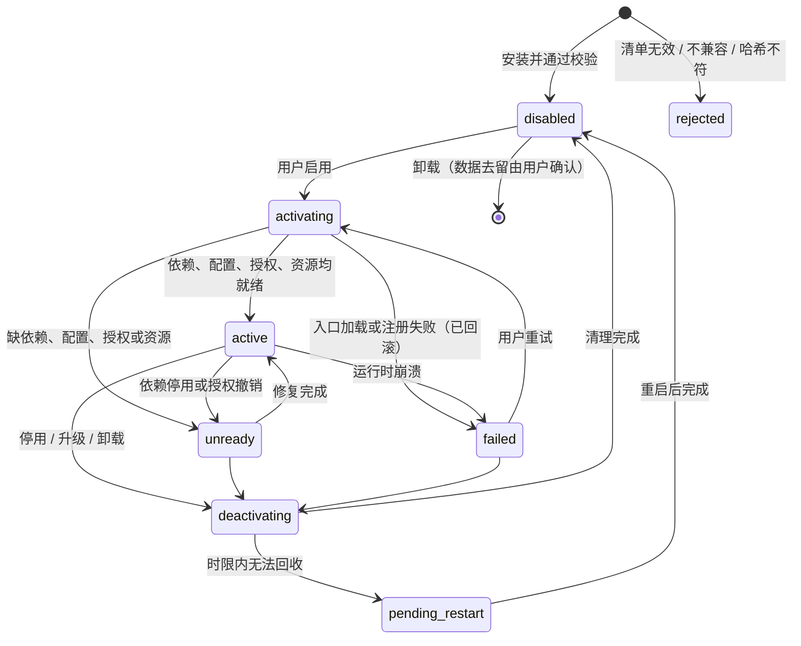

# 插件与能力契约草案 v0.1

状态：评审草案。依据已采纳的[ADR-0001](adr/0001-controlled-ui-contributions.md)（受控UI贡献点）、[ADR-0004](adr/0004-capability-centered-host.md)（能力中心）、[ADR-0008](adr/0008-local-and-cloud-asr.md)与[ADR-0009](adr/0009-cloud-asr-byok.md)（本地+云ASR、BYOK）、[ADR-0010](adr/0010-unified-plugin-model.md)（统一单层插件）和[ADR-0011](adr/0011-electron-typescript-desktop.md)（Electron + TypeScript）。

字段名、接口名、版本号与示例值都未冻结；本文不是已实现的SDK。插件信任与强制隔离方式（Q11）尚未选择，相关段落标注“取决于Q11”。

## 1. 契约要达成的效果

- **一种标准**：官方预装与外部安装的插件使用同一份清单、同一生命周期和同一能力契约。
- **依赖可解析、实现可替换**：插件通过能力声明协作，由用户显式选择实现，不靠加载顺序覆盖。
- **拆得干净**：命令、按钮、面板、热键、监听、任务、子进程和资源都有归属，停用后可以验证已释放。
- **天然不卡**：所有调用都是异步的，长任务可取消，流有顺序、结束与背压；契约里不存在同步阻塞的长调用。
- **权限可审查**：清单只是申请；用户授予后，由宿主在接口边界校验。

## 2. 核心概念

| 概念 | 含义 | 例子 |
| --- | --- | --- |
| 插件包 | 安装与卸载的发布单位，含清单与入口 | 本地ASR包 |
| 插件实例 | 一个插件包按某份配置运行的实体 | 同一云ASR包配两个账号（是否支持多实例待定） |
| 能力 | 带主版本号的接口契约 | `speech.asr@1` |
| 提供 | 插件实例注册某项能力的实现 | 本地ASR提供 `speech.asr@1` |
| 消费 | 插件声明需要某项能力（必需或可选） | 听写消费 `speech.asr@1` |
| 贡献点 | 宿主预留的标准交互入口 | 设置页、命令、快捷按钮、面板 |
| 任务 | 一次用户意图的执行单元，有标识、状态与取消 | 一次听写 |
| 世代号 | 插件实例每次启用时分配的递增编号，用于丢弃旧实例的晚到事件 | 停用后重新启用 |

## 3. 清单字段草案

| 字段 | 必填 | 含义与规则 |
| --- | --- | --- |
| `id` | 是 | 全局唯一标识；不得复用他人ID |
| `version` | 是 | 语义化版本 |
| `displayName` / `description` | 是 | 多语言显示名与说明 |
| `license` | 是 | 插件代码许可；模型、声音、素材在 `resources` 中逐项声明 |
| `host` | 是 | 兼容的宿主插件API版本范围；不满足时拒绝启用并说明原因 |
| `platforms` | 是 | 支持的平台与架构，例如 `win32-x64`；不支持时不提供启用 |
| `entries` | 是 | 按运行位置给出入口：插件运行区、受控UI内容、重计算或原生工作进程；最终运行位置由宿主政策决定（取决于Q11） |
| `provides` | 否 | 提供的能力、主版本与特性声明 |
| `consumes` | 否 | 需要的能力、必需或可选、版本范围 |
| `contributes` | 否 | 设置页、命令、热键请求、快捷按钮、面板 |
| `configSchema` | 否 | 配置结构与版本，用于生成设置表单、校验与迁移 |
| `permissions` | 否 | 申请的访问：麦克风、指定网络目的地、文字输入、屏幕捕获、剪贴板、凭据命名空间、文件范围、启动外部程序等 |
| `resources` | 否 | 需下载的模型或运行时：来源、大小、哈希、许可、是否可共享 |

两条硬规则：

1. **来源由宿主记录**，插件不能在清单里自称“官方”或“可信”。
2. **受保护标记不能由插件自己声明**，只由宿主的发行配置指定给少数基础模块。

### 示例：听写插件（示意值）

```jsonc
{
  "id": "official.dictation",
  "version": "0.1.0",
  "displayName": { "zh-CN": "语音听写", "en": "Dictation" },
  "license": "MIT",
  "host": "^0.1.0",
  "platforms": ["win32-x64"],
  "entries": { "host": "dist/host.js", "ui": "dist/ui/index.html" },
  "consumes": [
    { "capability": "audio.capture@1", "required": true },
    { "capability": "speech.asr@1", "required": true },
    { "capability": "text.input@1", "required": true }
  ],
  "contributes": {
    "commands": [{ "id": "dictation.toggle", "title": { "zh-CN": "开始/结束听写" } }],
    "hotkeys": [{ "command": "dictation.toggle", "suggested": "<待定>" }],
    "quickButtons": [{ "command": "dictation.toggle", "icon": "mic" }],
    "settings": [{ "id": "dictation.general" }]
  }
}
```

### 示例：本地ASR插件（示意值）

```jsonc
{
  "id": "official.asr-local",
  "provides": [{
    "capability": "speech.asr@1",
    "features": { "streaming": "segmented", "offline": true, "languages": ["<待定>"] }
  }],
  "entries": { "host": "dist/host.js", "worker": "dist/worker.js" },
  "resources": [{ "id": "<待选本地模型>", "sha256": "<固定后填写>", "license": "<逐项核验>", "shared": true }]
}
```

### 示例：云端ASR插件（示意值）

```jsonc
{
  "id": "official.asr-cloud-<服务商>",
  "provides": [{
    "capability": "speech.asr@1",
    "features": { "streaming": "native", "offline": false, "languages": ["<待定>"] }
  }],
  "permissions": [
    { "network": ["<服务商端点>"] },
    { "credentials": "asr-cloud" }
  ]
}
```

## 4. 生命周期



| 状态 | 贡献点 | 接新任务 |
| --- | --- | --- |
| 已拒绝 `rejected` | 不显示；插件列表说明原因 | 否 |
| 已安装未启用 `disabled` | 不显示（插件管理页除外） | 否 |
| 启用中 `activating` | 不显示 | 否 |
| 就绪 `active` | 显示 | 是 |
| 未就绪 `unready` | 显示为“需要修复”，点击进入修复入口 | 否 |
| 失败 `failed` | 显示错误、重试与停用 | 否 |
| 停用中 `deactivating` | 立即隐藏 | 否 |
| 待重启 `pending_restart` | 隐藏，提示重启以完成操作 | 否 |

生命周期保证：

- **激活是事务**：部分注册失败时，已注册的能力、贡献点和监听全部回滚，不留半启用状态。
- **停用有时限**：先拒绝新任务，再取消或收尾、清理、释放。运行在独立进程的插件超时后可被宿主终止；同进程插件无法强制回收时，只能标记为待重启，不能谎称已经卸载。
- **用世代号丢弃晚到事件**：旧世代的结果、事件和回执由宿主丢弃，不能复活已停用的功能。
- **依赖方降级**：被依赖的实现停用时，依赖方转为未就绪；只有用户事先批准的备选才可切换，且不得静默改变数据去向。

候选实现：Cordis 的 Fiber 生命周期与 dispose 自动回收，可以承载同进程部分；独立进程插件需要在宿主侧建立代理并映射状态。是否采用、采用哪条发行线，参见[平台调研](../research/tech-platform.json)，尚未冻结。

## 5. 能力契约通用规则

- **命名与版本**：`<领域>.<能力>@<主版本>`。不兼容变更必须升主版本；新旧主版本可在弃用期内并存（策略待定）。
- **特性声明**：清单中静态声明，运行时可用 `describe()` 查询。消费方据此调整界面，例如没有临时转录时显示“识别中”，而不是伪造逐字输出。
- **选择与绑定**：每项能力在设置中有“当前使用的实现”；多实现可以并存；任务开始时绑定，任务进行中不切换。
- **异步与任务**：所有调用异步，长任务返回任务句柄，不存在同步阻塞的长调用。
- **取消与截止**：每次调用携带取消信号与可选截止时间。跨进程时由宿主转发取消；提供方须在约定时限内停止产出（数值待性能预算）；取消后的产出由宿主丢弃。
- **错误分类**：`not-ready`、`invalid-input`、`auth-failed`、`quota-exceeded`、`rate-limited`、`network`、`unavailable`、`timeout`、`cancelled`、`internal`。每个错误带可展示的说明和是否可重试；不得包含密钥和用户内容。
- **流**：分块有序编号、明确的结束或错误、有背压（有界队列或额度机制），时间戳使用单调时钟。
- **健康与资源**：提供方报告加载中、就绪、占用设备或模型等状态，宿主汇总到诊断页。

## 6. 首条闭环的能力草案：听写

以下 TypeScript 只表达接口语义，不是冻结的 API。

```ts
interface TaskContext {
  taskId: string
  signal: AbortSignal   // 取消；跨进程时由宿主代理
  deadline?: number     // 单调时钟毫秒
}

// audio.capture@1：只负责采集，不知道音频将用于听写还是聊天
interface AudioCapture {
  describe(): Promise<{ devices: AudioDevice[]; formats: AudioFormat[] }>
  open(ctx: TaskContext, req: { deviceId?: string; format: AudioFormat }): Promise<AudioStream>
}
interface AudioStream {
  readonly format: AudioFormat
  frames(): AsyncIterable<AudioFrame>   // 有界；消费过慢时的策略待定
  stop(): Promise<void>                 // 结束录音，不等同于取消任务
}

// speech.asr@1：只把音频变成文字，从不执行系统输入
interface SpeechRecognizer {
  describe(): Promise<AsrFeatures>      // streaming: 'native' | 'segmented' | 'none'，语言，是否离线…
  recognize(ctx: TaskContext, input: {
    audio: AsyncIterable<AudioFrame>
    format: AudioFormat
    language?: string
    hints?: string[]                    // 词汇提示；是否支持见特性声明
  }): AsyncIterable<TranscriptEvent>
}
type TranscriptEvent =
  | { type: 'partial'; segment: number; revision: number; text: string }
  | { type: 'final'; segment: number; text: string }
  | { type: 'end' }

// text.input@1：只负责目标与提交，从不接触音频
interface TextInput {
  captureTarget(ctx: TaskContext): Promise<InputTarget>              // 记录本次目标
  check(ctx: TaskContext, target: InputTarget): Promise<TargetCheck> // 提交前复核：仍是同一目标？是否密码框或受限窗口？
  submit(ctx: TaskContext, target: InputTarget, text: string,
         mode: 'insert' | 'replace-selection'): Promise<InputReceipt>
}
interface InputReceipt {
  status: 'confirmed' | 'sent-unverified' | 'refused' | 'failed'
  method: string        // 实际使用的提交方式
  detail?: string
}
```

听写插件只负责编排：采集 → 识别 → 可选预览 → 复核目标 → 提交，并向界面发布任务状态：`idle → recording → recognizing → reviewing（若启用）→ submitting → done | failed | cancelled`。

必须保持的不变量：

1. 识别器拿到音频，但拿不到输入能力；输入能力拿到文字，但拿不到音频。
2. 提交前必须复核目标；目标变化时按已选策略询问或拒绝，不猜测。
3. 回执区分“已确认”和“已发送但无法验证”，界面不把后者显示成完全成功。
4. 取消后不再提交；旧世代的转录被丢弃。

## 7. 界面贡献点契约

- **首版候选**：设置页（优先由配置结构生成表单）、命令、热键请求、快捷按钮、结果或任务面板。首版具体开放哪些，随MVP细化确定。
- **渲染归属**：导航、外框、主题和授权对话框由宿主渲染。插件内容要么由配置结构生成，要么放在隔离容器中，通过消息通道与插件通信，只能调用已授权的接口。
- **热键**：插件只能“请求”热键；最终绑定由用户决定，冲突交给用户处理，不静默覆盖。
- **一致性**：遵守主题令牌、键盘可达和焦点管理规范；插件不得模仿宿主的授权界面。
- **清理**：停用即移除；停用后残留的入口视为缺陷。

## 8. 配置、数据与凭据

- **配置**：插件实例级配置带版本号；升级时由插件提供迁移，失败则回滚并保留旧配置。每个字段标注“立即生效 / 重载插件 / 重启应用”。是否引入“配置档”（多套用户配置）待定。
- **数据目录**：每个插件有私有目录。模型等共享资源由宿主资源管理登记引用；卸载时询问保留或删除，不误删仍被其他插件使用的资源。
- **凭据**：BYOK的Key由宿主凭据代理保存，插件只能申请自己命名空间下的凭据，不写入普通配置或日志；具体保护方式待选。平台调研记录：最新Electron文档对同步safeStorage接口有弃用和移除计划；它在Windows上基于DPAPI，不能防同一用户的其他进程，须按锁定版本核实，见[平台调研](../research/tech-platform.json)。

## 9. 权限：声明、授予与执行

- **三件事分开**：清单声明只是申请；用户授予才生效；宿主在接口边界执行校验。
- **两侧授权**：提供方访问系统资源需要授权（本地ASR不需要麦克风，采集插件需要）；消费方使用敏感能力也需要授权（例如“听写可以使用录音能力”）。这样，任意一个插件都不能借用录音能力偷听。
- **范围与期限**：本次、本次运行、持续三种，均可撤销。撤销后新调用被拒绝，进行中的任务按策略取消。
- **审计**：记录谁在何时使用了哪项敏感能力、作用于哪个目标；默认不记录内容本身。
- **取决于Q11**：若选“可信插件优先”，上述约束覆盖通过SDK的调用，插件绕过SDK直接访问系统不能被技术阻止，依靠来源信任；若选“受限运行环境”，普通脚本插件只能通过宿主接口访问系统，原生插件另设高信任。

## 10. 版本与兼容

- 宿主插件API使用语义化版本；清单的 `host` 范围不满足时，启用前拒绝并说明原因。
- 能力主版本在弃用期内可并存，弃用期和提示方式待定。
- 插件升级：停用旧版并收尾任务 → 迁移配置 → 启用新版；失败则回滚到旧版。
- 契约测试套件随SDK发布；官方插件同样必须通过，以证明第三方能做出同等扩展。

## 11. 每个插件都要通过的契约测试

| 类别 | 验证内容 |
| --- | --- |
| 生命周期 | 启用、停用、再启用后，无残留监听、定时器、贡献点、子进程 |
| 依赖 | 缺依赖时进入未就绪；依赖停用后正确降级 |
| 取消 | 在每个阶段取消，确认不再产出、不再提交 |
| 晚到结果 | 旧世代的事件和结果被丢弃 |
| 故障注入 | 提供方崩溃、超时、报错时，错误分类正确，宿主界面保持可用 |
| 配置迁移 | 旧配置可以升级，失败可以回滚 |
| 权限 | 未授权调用被拒；撤销立即生效 |

## 12. 待定事项

- Q11：插件信任与强制隔离方式。
- 插件框架的具体发行线、版本和跨进程代理协议。
- 包格式与安装来源（本地目录、压缩包、包管理器或其他）。
- 同一插件包是否支持多实例，是否引入“配置档”。
- 首版开放的贡献点清单。
- 音频格式、背压机制、取消时限与超时等数值。

验收场景见[候选场景](07-use-cases-and-acceptance.md)；听写细节见[听写PRD](09-dictation-mvp-prd.md)与[ASR双路径规格](10-asr-providers-and-dataflow.md)；运行边界见[Electron运行边界](12-electron-runtime-boundaries.md)。
