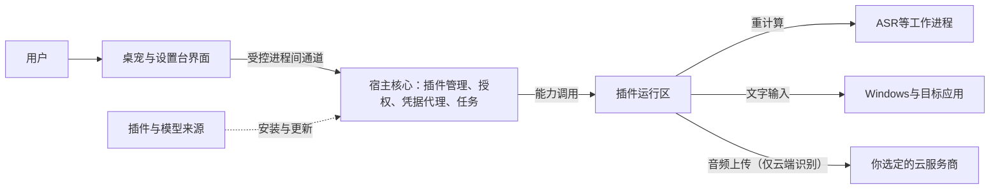

# 安全与隐私策略草案 v0.1

状态：草案。基于已确认的决策：独立运行、Windows首发、Electron + TypeScript、统一单层插件、听写优先、本地与云端ASR、云端使用用户自带Key。插件信任已按DSH方案确定（[ADR-0012](adr/0012-dsh-style-trust-and-permissions.md)）；数据保存（Q22）、匿名统计（Q23）、更新与签名（Q24）尚未决定，相关条目标为“待你决定”。本文不是安全审计结论，也不代表任何功能已经实现。

屏幕内容与电脑操作不在首条闭环内，进入排期时单独评审。

## 1. 首条闭环涉及的数据

| 数据 | 敏感程度 | 用途 | 去向与保存 |
| --- | --- | --- | --- |
| 麦克风录音 | 高 | 识别成文字 | 本地识别不离开本机识别链路；云端识别只发给你选定并批准的服务商（已定）。是否落盘、保存多久：待你决定 |
| 转录文字 | 高（可能包含任何内容） | 写入目标应用；可能用于预览和撤销 | 历史是否保存、保存多久：待你决定 |
| 目标应用信息（进程名、窗口标题、控件类型） | 中（窗口标题可能暴露文件名或聊天对象） | 目标绑定与兼容性诊断 | 默认不把全文写入日志；诊断需要时脱敏 |
| 云服务商API Key | 高 | 调用云端识别 | 只经宿主凭据代理保存和使用，不进普通配置和日志（已定） |
| 插件包与模型文件 | 完整性敏感 | 提供能力 | 记录来源与哈希，校验通过才加载 |
| 配置与偏好 | 低到中 | 恢复用户设置 | 保存在本机 |
| 诊断日志 | 视内容而定 | 排查问题 | 默认不含录音、转录全文和Key；保留期限待你决定 |
| 剪贴板（若作为写入回退） | 高 | 粘贴长文本 | 是否使用、怎样恢复，随文字输入方式确定 |

## 2. 信任边界

| 边界 | 规则 |
| --- | --- |
| 界面 → 宿主 | 宿主校验每个请求的来源、类型和目标；界面不能自己决定授权 |
| 宿主 → 插件 | 插件的敏感操作必须先获授权；宿主在接口边界校验 |
| 插件 → 系统 | 插件代码按可信程序运行，不阻止其绕过接口直接访问系统（按DSH方案）；安装与启用插件需你明确确认 |
| 本机 → 云端 | 只发往批准的目的地；不静默增加新的数据去向 |
| 来源 → 本机 | 安装与更新时校验来源和完整性 |

## 3. 主要风险与对策

| # | 风险 | 会发生什么 | 对策 | 状态 |
| --- | --- | --- | --- | --- |
| 1 | 文字写错地方 | 录音时切换了窗口，内容进了别的聊天框 | 开始时记录目标，提交前复核；目标变化时询问或拒绝 | 已写入契约草案 |
| 2 | 覆盖原有文字 | 整框替换导致用户原文丢失 | 只用“光标处插入”和“替换选区”两种明确模式，不默认整值替换 | 已写入契约草案 |
| 3 | 录音被意外上传 | 本地识别失败后悄悄改用云端 | 不自动切换数据去向，切换须用户确认；界面显示当前在本地还是云端识别 | 已定（ADR-0008） |
| 4 | 后台偷听 | 某插件在用户不知情时打开麦克风 | 录音能力按“谁在用”单独授权；录音时桌宠和托盘都有明显标识；记录使用审计 | 方向已定；插件绕过接口直接访问麦克风无法用技术阻止，依靠安装时的信任确认 |
| 5 | API Key泄露 | Key出现在配置、日志、崩溃报告中，或被其他插件读到 | 宿主凭据代理保存；插件只能取自己命名空间的凭据；日志与错误信息脱敏；安装包里不放共享Key | 方向已定（ADR-0009）；保护机制待选 |
| 6 | 恶意或被篡改的插件、模型 | 装了被植入恶意代码的插件，或模型被替换 | 宿主记录来源；模型与资源校验哈希；陌生插件启用前明确告知能力范围；不自动安装依赖 | 信任模型已定（ADR-0012）；更新与签名待Q24 |
| 7 | 伪造授权界面 | 插件面板画一个像宿主授权的按钮诱导点击 | 授权只由宿主界面发起；插件内容在隔离容器中，无法触发授权 | 已写入契约草案 |
| 8 | 写入密码框或高权限窗口 | 听写内容写进密码框；尝试向管理员窗口输入 | 检测到密码类控件就拒绝；普通程序本就无法向高权限窗口输入，界面显示“不支持”而不是静默失败 | 已写入场景验收 |
| 9 | 剪贴板副作用 | 用剪贴板粘贴长文本时覆盖用户内容，或进入剪贴板历史与云同步 | 若采用：写入时设置排除历史与云同步的标记；恢复前检测用户是否复制了新内容，有则不恢复；说明恢复只能尽力而为 | 随文字输入方式确定 |
| 10 | 晚到结果与重复提交 | 取消后旧转录仍被写入；重试导致重复输入 | 世代号丢弃旧结果；回执区分“已确认”和“无法验证”；无法确认时先核对再重试 | 已写入契约草案 |
| 11 | 本机接口被其他程序调用 | 为界面或插件开放的本地HTTP或WebSocket端口被同机其他程序调用 | 优先用不开放端口的进程间通道；必须开放时每次请求都校验会话令牌 | 待实现设计 |
| 12 | 授权撤销不彻底 | 关闭功能后重新开启，旧授权仍然有效 | 停用插件、关闭功能、重启时都清除其临时授权；重连不恢复已撤销的授权 | 已写入契约草案 |
| 13 | 日志与崩溃报告泄露内容 | 诊断资料中带有转录、窗口标题或Key | 默认脱敏；发送诊断须用户主动操作 | 统计与发送待Q23 |
| 14 | 资源耗尽 | 插件或模型占满CPU、显存，拖慢整台电脑 | 重计算进程隔离；资源监控；用户可一键停止 | 与流畅性要求共用 |
| 15 | 更新被劫持 | 下载到被篡改的更新包 | 校验签名或哈希 | 待Q24 |

## 4. 参考项目给出的教训（只作参考，不复用代码）

| 观察 | 教训 | 来源 |
| --- | --- | --- |
| Coopanion的桌宠本地HTTP/WS接口：窗口通道使用启动时生成的随机密钥；浏览器写请求有同源限制，但不带Origin的本机客户端可以通过 | 同源检查挡不住同机其他程序；优先使用不开放端口的进程间通道 | [server.ts（固定提交）](https://github.com/Pal-AI-Lab/Coopanion/blob/3dd0892c2d70a026253ab980af392302b88ff8b1/packages/cortico-world-desktop-pet/src/server.ts#L160-L231) |
| Coopanion电脑操作：一轮对话结束会清除权限，但关闭开关或结束引擎时没有清除限时授权（静态核查推断，未复现） | 撤销要覆盖“关闭、停用、重启”所有出口 | [cua.ts（固定提交）](https://github.com/Pal-AI-Lab/Coopanion/blob/3dd0892c2d70a026253ab980af392302b88ff8b1/packages/cortico-world-desktop-pet/src/cua/cua.ts#L153-L194) |
| Coopanion模型服务的密钥保存在服务目录下的.env文件中 | Key不应以明文配置文件保存 | [companion.ts（固定提交）](https://github.com/Pal-AI-Lab/Coopanion/blob/3dd0892c2d70a026253ab980af392302b88ff8b1/core/companion.ts#L78-L84) |
| VPet核心插件直接加载DLL；官方2026-09公告披露热门MOD被盗用、植入病毒后重新上传，随后增加了拦截与哈希签名校验 | 插件生态从一开始就要考虑来源与完整性校验 | [产品调研](../research/product-benchmarks.json) |
| Electron safeStorage在Windows上基于DPAPI，能防同机其他用户，不能防同一用户下的其他程序；最新文档标注同步接口自Electron 45弃用、计划在46删除 | 凭据保护按锁定版本选择接口，并限制插件拿到解密能力 | [平台调研](../research/tech-platform.json) |
| Windows提供剪贴板格式标记，可把内容排除出剪贴板历史与云同步；剪贴板序列号可检测内容是否被他人改动 | 剪贴板回退时设置排除标记，恢复前先检测 | [Windows自动化调研](../research/tech-windows-automation.json) |

## 5. 用户能看到、能控制的安全功能（首版建议）

- **录音标识**：录音时桌宠和托盘都有明显标识，停止后立即消失。
- **数据去向**：设置台和录音状态中显示“本地识别”或“云端识别（服务商名）”。
- **权限页**：列出每个插件已获得的授权，可逐项撤销。
- **使用记录**：记录敏感能力的使用情况（谁、何时、对什么目标），默认不含内容本身。
- **一键停止**：一个全局入口，立即取消所有任务，停止录音和输入。

入口的具体形式随设置台与贡献点设计确定。

## 6. 插件信任与操作审批（按DSH方案）

已决定，见[ADR-0012](adr/0012-dsh-style-trust-and-permissions.md)。

| 项目 | 做法 |
| --- | --- |
| 插件代码 | 按可信本机程序运行，不做代码沙箱；安装或启用插件是一次信任决定，需你明确确认 |
| 插件依赖的构建或安装脚本 | 单独确认，不随插件安装自动执行 |
| 敏感操作 | 权限预设规定“自动执行”或“需审批”；默认预设的内容随相关功能确定 |
| 审批 | 只对这一次操作有效，不形成长期授权；想长期免询问就调整预设 |
| 审批通道不可用 | 默认拒绝 |
| 等待审批时取消 | 撤回询问，晚到的答复被丢弃 |
| 审计 | 每次审批请求与结果都记录 |
| 进程分离 | 用于流畅与故障隔离，不是安全边界 |

这意味着首版不承诺阻止恶意插件绕过接口访问系统，安装来源与信任确认是主要防线。以后开放陌生第三方插件生态时，可再评估受限运行环境。

## 7. 安全与隐私验收（候选）

| 编号 | 条件 | 期望 |
| --- | --- | --- |
| SEC-01 | 未获授权的插件请求录音 | 被拒绝，并能在使用记录中看到 |
| SEC-02 | 本地识别失败 | 不自动改用云端，提示用户选择 |
| SEC-03 | 扫描日志与崩溃资料 | 不含Key、录音或转录全文 |
| SEC-04 | 目标是密码框 | 拒绝写入并说明原因 |
| SEC-05 | 撤销某插件的授权 | 新调用立即被拒；进行中的任务按策略取消 |
| SEC-06 | 插件面板尝试触发授权 | 无法触发；授权只出现在宿主界面 |
| SEC-07 | 同机其他程序尝试调用本机接口 | 被拒绝（若存在本机接口） |
| SEC-08 | 模型文件哈希不符 | 拒绝加载，提示重新下载 |
| SEC-09 | 停用后重新启用插件 | 旧的临时授权不会恢复 |
| SEC-10 | 审批通道不可用 | 敏感操作被拒绝，不会默认放行 |
| SEC-11 | 等待审批时取消任务 | 询问被撤回，晚到的答复被丢弃 |
| SEC-12 | 同一操作第二次发生 | 上一次的审批不会自动放行第二次，除非预设允许 |

## 8. 待你决定

- Q22：录音、转录与日志是否保存、保存多久。
- Q23：是否收集匿名使用统计。
- Q24：更新方式，以及是否做代码签名。
- 凭据保护的具体机制：Electron版本锁定后，由我查证并推荐。

相关文档：[契约草案](13-plugin-contract-draft.md) · [测试策略](14-test-and-acceptance-strategy.md) · [Electron运行边界](12-electron-runtime-boundaries.md) · [场景验收](07-use-cases-and-acceptance.md)
