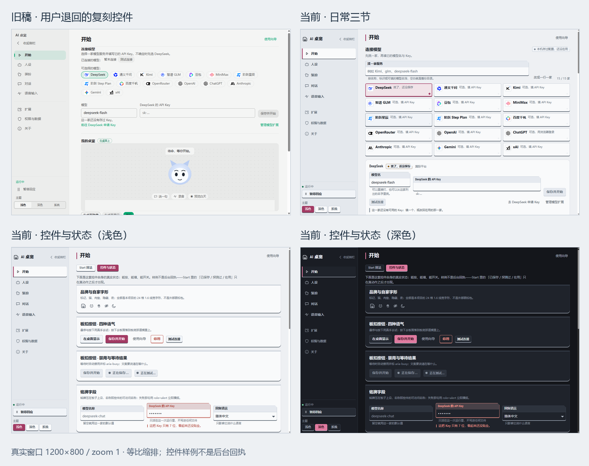

# 原创 Start 控件评审

原创控件验收完成：基础原生 10/10 组、27 张截图，随后完整 `pnpm check` 通过；折叠侧栏修正另经 43 项定点检查与稳态原生增量通过（6 图）。独立视觉复审 PASS，当前无 P1/P2 阻塞。执行证据统一见 [QA 执行记录](original-controls-results.md)。

## 从退回稿到当前实现

用户退回的是 Coopanion 复刻控件语言。保留的 [上一轮五版对照](screenshots/start-design-lab/start-lab-1793272859631-b3d0f795/overview-light.png)及其原生报告只作为历史功能与退回稿证据。当前普通入口「日常三节」和五个评审排法共用新控件；组件样板台明确标注为样例，真实连接回执仍来自宿主动作。

| 家族       | 当前实际结构与交互                                                                                  | 源码证据                                                                                                                                                                                                                                   |
| ---------- | --------------------------------------------------------------------------------------------------- | ------------------------------------------------------------------------------------------------------------------------------------------------------------------------------------------------------------------------------------------ |
| 控件与状态 | 板底按压按钮、切角铭牌字段、方销开关、选择瓦片、状态牌与结果通知；原生禁用/等待/错误/选中及标签关联 | [七个控件](../apps/desktop/src/renderer/console/original-ui/kit.tsx)、[结构令牌](../apps/desktop/src/renderer/console/original-ui/design-tokens.css)、[状态样板台](../apps/desktop/src/renderer/console/original-ui/control-board.tsx)     |
| 外壳       | 自家标记与字形、分隔导航、常驻 Core 运行控制、原生主题单选板；导航保留同一窗口 URL                  | [设置外壳](../apps/desktop/src/renderer/console/settings-shell.tsx)、[控制台接线](../apps/desktop/src/renderer/console/console-app.tsx)                                                                                                    |
| 厂商与连接 | 名称/标识/模型搜索，井格目录或一行一家；选择与实际在用分开，保存/探测/在用三条事实分别显示          | [展示控件](../apps/desktop/src/renderer/console/start-designs/sections.tsx)、[状态与动作](../apps/desktop/src/renderer/console/start-designs/use-start-model.ts)、[纯判断](../apps/desktop/src/renderer/console/start-designs/behavior.ts) |
| 桌宠预览   | 场景井格、工具排、输入与菜单抽屉；沿用原创角色、共享聊天/录音/互动回执。日夜只改变这块预览          | [原创预览](../apps/desktop/src/renderer/console/original-ui/pet-preview.tsx)、[场景与角色样式](../apps/desktop/src/renderer/console/original-ui/pet-preview.css)                                                                           |
| 配色       | 青港（默认）、翠晓、陶烬；三种明暗模式、36 项颜色、独立明暗自定义变体与撤销试色                     | [配色工作室](../apps/desktop/src/renderer/console/original-ui/theme-studio.tsx)、[同一事务控制器](../apps/desktop/src/renderer/console/original-ui/theme-controller.ts)、[配色与迁移](../apps/desktop/src/renderer/console/theme.ts)       |

Start 的展示片段由新控件生成后交给版式摆放；实际状态与动作保留在既有配置、Core、凭据、会话和录音所有者中。模型名与 Key 草稿位于版式之外，Key 仅在内存；配色试色随工作区卸载撤回。旧内置方案 ID 映射到新方案，保存的模式与自定义方案保留。

## 查看与选择

通过 [独立评审启动器](../Start-Design-Lab.cmd)打开实际 Electron 入口；「控件与状态」查看样板，「Start 排法」查看日常三节与五个方案。评审资料独立，默认落在并肩工作台；这不代表已经选择生产方案。

| 方案         | 适用方式                       | 主要取舍             |
| ------------ | ------------------------------ | -------------------- |
| 并肩工作台   | 桌宠与接线并排，一边看一边配置 | 窄窗口改为上下排列   |
| 模型接线台   | 服务目录常驻，集中编辑当前厂商 | 桌宠位于详情下方     |
| 从连接到见面 | 按新手顺序展开三段             | 经常展开、收起       |
| 桌宠在场     | 先见角色，再打开接线与配色抽屉 | 配置操作需要多滚一段 |
| 三页工作簿   | 共享状态栏下使用三个整宽工作页 | 同一屏看不全三件事   |

## 实际截图

五版同尺寸对照：[浅色](screenshots/original-controls/start-lab-1793296307496-9b1e65c4/overview-light.png)、[深色](screenshots/original-controls/start-lab-1793296307496-9b1e65c4/overview-dark.png)。图像只等比缩排真实截图，来源与摘要见[合成清单](screenshots/original-controls/start-lab-1793296307496-9b1e65c4/comparison-manifest.json)。折叠栏最终状态见增量[浅色 1200](screenshots/original-controls/collapsed-1793300116862-5ff40377/collapsed-light-1200x800.png)、[深色 880](screenshots/original-controls/collapsed-1793300116862-5ff40377/collapsed-dark-880x600.png)。

## 验证状态

| 检查       | 实际结果与证据                                                                                                                                                                                                                                                                                          |
| ---------- | ------------------------------------------------------------------------------------------------------------------------------------------------------------------------------------------------------------------------------------------------------------------------------------------------------- |
| 基础原生   | [完整报告](screenshots/original-controls/start-lab-1793296307496-9b1e65c4/acceptance-report.json) 10/10 通过，27 幅 1200×800 / 880×600 截图，zoom 1；三个进程 code 0 / signal null / forced false；无 renderer 异常或 renderer 远端请求                                                                 |
| 功能与状态 | 正常入口/样板、五版草稿/实际 Core 回应与历史、保存后网络拒绝、暂停/显隐/向导、预览拖动/键盘/菜单、36 色 CRUD/明暗变体、抽屉退出撤试色、五版最小窗口/缩放/焦点/减少动画、应用重启均通过                                                                                                                  |
| 工作区检查 | [实际完整输出](screenshots/original-controls/start-lab-1793296307496-9b1e65c4/workspace-check.log)：typecheck、523 项桌面测试（52 文件）、其余 workspace 测试、QA 120 通过/1 跳过/0 失败、lint、格式、build 全部通过；这次检查先于下述折叠栏 CSS 增量                                                   |
| 独立视觉   | UI Finish-Gate Reviewer [实际复审 PASS](../.trellis/tasks/archive/2026-10/10-29-original-start-controls/research/visual-review.md)：原创语言符合，头像/窄场景关闭，无 P1/P2；厂商名称折行是可选优化                                                                                                                     |
| 折叠栏增量 | [最终稳态报告](screenshots/original-controls/collapsed-1793300116862-5ff40377/acceptance-report.json)通过；此前外壳所有者 43 项定点测试及格式检查通过。1200×800 与 880×600 均等到 72px 后测量，三档主题分别通过指针与键盘激活，标签/点击区完整可见，2px 焦点线与 2px 偏移无裁切；6 图、单次进程 clean 0 |

基础与最终增量源码摘要、47 项当前文件指纹及仅有的两项变化（probe、侧栏 CSS）见[合并证据](screenshots/original-controls/start-lab-1793296307496-9b1e65c4/integration-evidence.json)。已核阅正常浅色、浅深控件样板、深色工作台与最小窗口及两张五版对照：头像可见，窄预览工具提示未逐字挤压，实际 22 字 Core 回复保持两行。保存、探测、当前在用与默认端点的 Key 状态分别报告；Stage 兄弟抽屉事件不会撤掉刚打开的配色工作区。

`replicate-then-redesign` 的独立组件语言与证据模板已读回；`quick_validate.py` 输出 `Skill is valid!`，退出 0。元数据校验与此前前向行为证据见[技能验证记录](replica-redesign-skill-results.md)，本轮不新增前向测试声明。

已通过发布的 CAS 文件操作移除本任务六次失败运行的 57 幅 PNG，保留失败报告、全部接受图和前任务退回稿；44 幅保留图的前后摘要一致，见[清理审计](screenshots/original-controls/start-lab-1793296307496-9b1e65c4/failed-capture-cleanup.json)。

设计规则与材料来源统一见[设计系统账](../.trellis/tasks/archive/2026-10/10-29-original-start-controls/research/design-system.md)；本轮没有新增外部控件代码、字体下载或图标包。真人登录、付费模型成功和麦克风采集不在本轮新原生证明范围。
