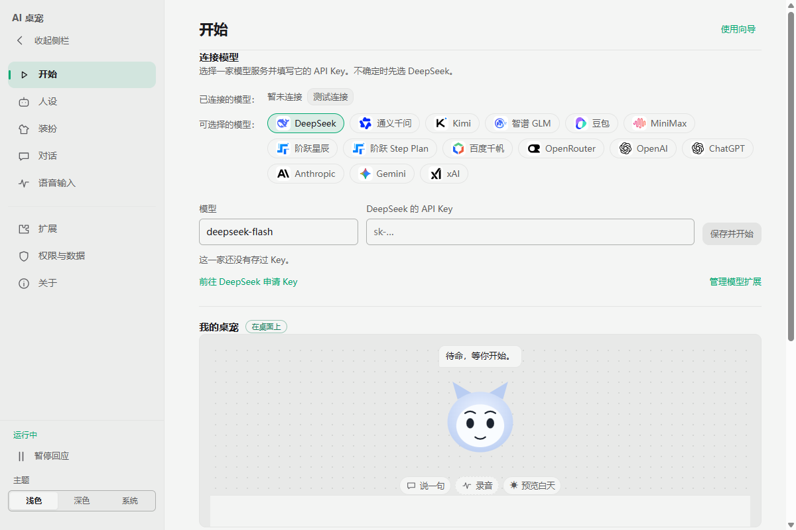

# 开始栏对照

栏目与功能以本地Coopanion0.2.10源码（4afc70898ac1065dd4559d891a2ce0bebd1261f8）为准。其README中的开始页截图显示版本0.1.19，仅用于排版/色调对照；标题、当前服务和按钮顺序按0.2.10源码。当前项目保留自有角色与品牌。

| 参考视觉（0.1.19） | 当前实现（真实窗口1200×800、100% zoom） |
| --- | --- |
|  |  |

[黑夜](./coop-start-1793262754337-88ae2a0b/dark-1200x800.png) · [调色盘](./coop-start-1793262754337-88ae2a0b/palette-1200x800.png) · [880×600](./coop-start-1793262754337-88ae2a0b/minimum-880x600.png) · [折叠侧栏](./coop-start-1793262754337-88ae2a0b/rail-collapsed-1200x800.png)

[原生验收报告](./coop-start-1793262754337-88ae2a0b/acceptance-report.json)通过12组，两个应用进程均确认正常退出。覆盖15服务/地区切换、实际拒绝网络后的保存状态、36项调色与重启、显隐、真实预览表情/聊天/菜单/拖动、键盘及不可拖动点按、使用向导。Core/录音/历史仍为既有单一所有者。

原资料启动另见[正常启动结果](../../start-normal-results.json)。模型账户测试使用本地可控响应，未进行真人授权或付费调用。
