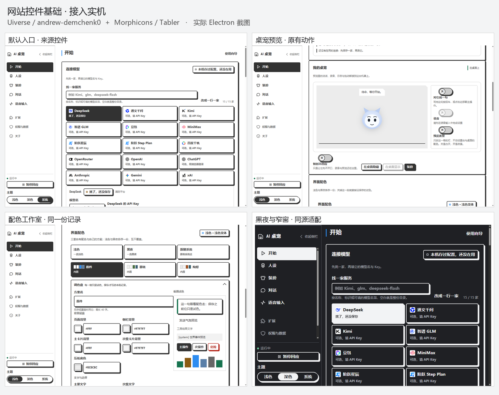

# 网站控件基础：Uiverse + Morphicons

默认开始页与共享设置外壳已采用网站控件基础并验收。采用的是 Uiverse 作者 **andrew-demchenk0** 的相关现成组件；新增布局与反馈沿用这组组件的材料规则。它是同作者的组件组合，不是网站发布的完整设计系统。

双击 [Start-Website-Style.cmd](../Start-Website-Style.cmd) 查看正常界面。此入口使用独立预览资料，打开默认开始页；原始代码与接入版另有可操作对照板。

## 具体采用哪些原件

| 用途     | 原件                                                                         | 保留与适配                                                                                                                        |
| -------- | ---------------------------------------------------------------------------- | --------------------------------------------------------------------------------------------------------------------------------- |
| 按钮     | [afraid-squid-51](https://uiverse.io/andrew-demchenk0/afraid-squid-51)       | 保留2px描边、5px圆角、4px硬投影和按压3px；中文动作、流式宽度、键盘、等待/禁用为适配                                               |
| 输入     | [polite-stingray-67](https://uiverse.io/andrew-demchenk0/polite-stingray-67) | 保留描边、圆角、投影与焦点蓝；补原生label、提示/错误关联。原片段content-box外高54px，项目border-box外高40px，14px尺寸差异明确记录 |
| 开关     | [empty-penguin-100](https://uiverse.io/andrew-demchenk0/empty-penguin-100)   | 保留100px圆轨、30px钮、状态文字及整轨−32px/钮+32px运动；补名称、描述、键盘与禁用                                                  |
| 选项组   | [stupid-seahorse-9](https://uiverse.io/andrew-demchenk0/stupid-seahorse-9)   | 主题三态采用34px/50px胶囊、2px描边、4px投影和选中反色；宽度按栏位收缩，宽处仍保留原250px                                          |
| 面板材料 | [afraid-cougar-9](https://uiverse.io/andrew-demchenk0/afraid-cougar-9)       | 采用表单面板的描边、圆角、投影与间距；登录和翻转业务未移植，原样表单另放在600px展示画布                                           |

原始HTML/CSS、作者注释、MIT许可和实际代码对应关系在[来源清单](../apps/desktop/src/renderer/console/site-ui/source-manifest.json)及[原件目录](../apps/desktop/src/renderer/console/site-ui/upstream/)。官方Galaxy固定提交为`adbd2adde0a299a3956ea288fb444ec01891ca41`；Uiverse网页在本环境返回Cloudflare403，因此来源证据采用其公开官方固定代码与真实离线渲染。

图标选取 [Morphicons](https://www.morphicons.com/) 支持的17枚Tabler outline字形，使用morphicons2.0.2作实际形变。Tabler固定提交为`ed177a085b652fe04ec4f37ced867c94621e7840`；[Tabler MIT](../apps/desktop/src/renderer/console/site-ui/assets/TABLER-LICENSE.txt)与[Morphicons MIT](../apps/desktop/src/renderer/console/site-ui/assets/MORPHICONS-LICENSE.txt)均保留。导航与部分两态动作使用这些资源，品牌和角色插图仍是项目资产。

[按钮原件／接入版](screenshots/site-sourced-controls/site-1793371094295-970b0c13/01-button-paired-source-rest.png) · [开关同状态对照](screenshots/site-sourced-controls/site-1793371094295-970b0c13/06-switch-both-checked-track-knob.png) · [原始表单完整展示](screenshots/site-sourced-controls/site-1793371094295-970b0c13/08-raw-form-contained-canvas-and-source-notes.png)

## 应用接线与额外设计

正常开始页的模型连接、预览操作与36格配色编辑改用Source组件，复用既有模型、凭据、Core、历史、录音、偏好和主题事务。稳定内置ID`slate-harbor`现在名为「原件」，默认值是白底、墨线、焦点蓝；其他内置、自定义方案、模式和选择继续读取同一份有效记录，试色与撤销也由它落地。评审专用的额外颜色归属分支已删除。

文字、响应尺寸、原生语义/键盘、禁用/等待/错误和深色属于适配。目录、状态回执、菜单与外壳布局属于同源规则的本地补充。此次范围是普通开始页和共享外壳；其他功能页正文、既有ui-kit对话框/提示及角色插图未广重做。

## 验证

| 证据                                                                                                      | 结果                                                                                                                                    |
| --------------------------------------------------------------------------------------------------------- | --------------------------------------------------------------------------------------------------------------------------------------- |
| [完整普通入口功能基线](screenshots/site-sourced-controls/site-1793368428622-2b2027bd/native-report.json)  | 14/14通过、28张截图，覆盖保存/拒绝/启用真值、认证取消、共享Core与单次互动、显隐/菜单/真实向导、36色事务、自定义方案和重启               |
| [最终视觉与来源复验](screenshots/site-sourced-controls/site-1793371094295-970b0c13/native-report.json)    | 6/6通过、24张截图、95项材质比较一致；验证1200/880、亮/暗、折叠栏、局部边界与投影、选中对比、Key语义、5类来源、17字形及真实形变/减少动效 |
| [完整工程检查原始日志](screenshots/site-sourced-controls/site-1793371094295-970b0c13/workspace-check.log) | `pnpm check`退出0；桌面62文件634测试通过，全部工作区检查通过                                                                            |
| [当前交付文件清单](screenshots/site-sourced-controls/current-delivery.json)                               | 产品源与最终原生版本完全相同，40个构建文件摘要相同；仅QA驱动有无副作用的未用声明删除及研究目录归档路径更新                              |

四处实测问题已关闭：选项组含投影右端239px位于248px侧栏内；折叠时63px位于72px侧栏内；选中副文反色可读；主题仅一个原生legend；Key错误提示与字段相符。原始表单含投影完整落在600px画布中，原件字节未改。

14项功能基线与最后6项视觉复验对应不同的已记录快照；后者只接受经过审查的CSS/标题/文案改动，没有声称把旧14项在新版本重新执行。所有原生进程正常退出，无renderer异常或观察到的远端请求。完整执行范围与记录仅在[QA结果](site-sourced-controls-results.md)维护。
