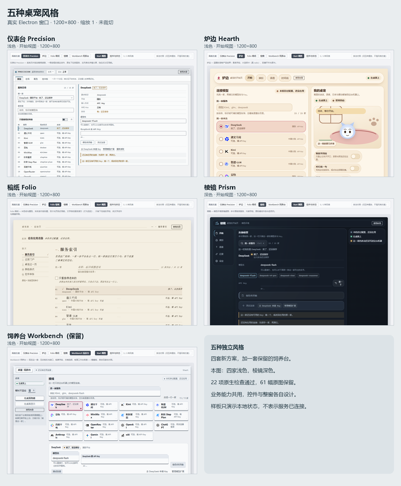

# 五种 Start 风格与控件评审

当前结论：**五套完整窗口与控件语言已交付，22/22 原生检查及完整工作区检查通过。** 本轮按五种风格计数：四套新方案 Precision、Hearth、Folio、Prism，加一套明确保留的 Workbench。普通生产入口继续使用原 PB「日常三节」，尚未替用户选择新方案。本文是本轮唯一的方案与取舍评审；运行明细由[原生 QA 记录](style-families-results.md)维护。

通过[独立评审启动器](../Start-Design-Lab.cmd)进入，顶端「风格方案」选择整扇窗，「Start 视图 / 控件与状态」切换真实业务视图和本地样板。「排法对照」保留此前一套 kit 的五种摆放；这些旧排法不计入本轮五种风格。评审默认 Precision，只是查看起点。当前[登记处](../apps/desktop/src/renderer/console/style-families/registry.ts)五个组件均已接入；[评审层](../apps/desktop/src/renderer/console/style-families/gallery.tsx)只提供中立选择条，各家自绘标题、导航、正文与页脚。

[五套控件与状态样板](screenshots/style-families/native-1793332708298-af4a8e82/derived/five-boards-representative.png) · [统一浅色对照](screenshots/style-families/native-1793332708298-af4a8e82/derived/five-styles-light.png) · [统一深色对照](screenshots/style-families/native-1793332708298-af4a8e82/derived/five-styles-dark.png)

## 五套实际结构与取舍

下表依据当前实现；适用情境与取舍是供用户选择的判断。字体使用本机字体栈，未新增远程字体。

| 家族与实现                                                                                                                                                                | 字体、材质与整窗                                                                      | 服务选择、字段与动作                                                                                 | 开关、反馈与样板                                                                             | 适用情境与取舍                                                                 |
| ------------------------------------------------------------------------------------------------------------------------------------------------------------------------- | ------------------------------------------------------------------------------------- | ---------------------------------------------------------------------------------------------------- | -------------------------------------------------------------------------------------------- | ------------------------------------------------------------------------------ |
| [Precision 仪表台](../apps/desktop/src/renderer/console/style-families/precision.tsx) · [样式](../apps/desktop/src/renderer/console/style-families/precision.css)         | 系统无衬线 + 等宽读数；中性平面、细描边；顶栏读数与挡位 tab，左目录右详情             | 原生 select + 可筛表格行；28px 描边字段；描边动作与实心主按钮                                        | 行式 switch；dl/dt/dd 读数与分开的保存/探测/在用回执；控件板展示原生下拉、动作、字段、目录行 | 适合频繁配置和比较端点；信息密度高，桌宠与配色需切分区查看                     |
| [Hearth 炉边](../apps/desktop/src/renderer/console/style-families/hearth.tsx) · [样式](../apps/desktop/src/renderer/console/style-families/hearth.css)                    | Candara/Corbel 与中文 UI 字体；暖色厚卡、软阴影、圆角；连接与配色一列，桌宠插画窝一列 | label 包裹的真 radio 大卡；柔底填充字段；胶囊 CTA 与文字动作                                         | 胶囊开关、状态卡与页脚句；样板可选卡、填字段、触发错误与本地等待                             | 适合首次设置和陪伴感；卡片占空间，目录长时滚动较多                             |
| [Folio 稿纸](../apps/desktop/src/renderer/console/style-families/folio.tsx) · [样式](../apps/desktop/src/renderer/console/style-families/folio.css)                       | 本机宋体系衬线 + 等宽注记；纸面、细规则与宽行距；目次、页码、章节正文                 | ol 文字索引，条目按钮以 aria-pressed 与 ✓ 复认选择；下划线字段；纯文字动作                           | 真 checkbox 勾选行；骑缝存根和边注；样张包含划线字段、文字动作、勾选、索引与回执             | 适合慢读和逐项整理；服务索引与填写分章节，步骤更多                             |
| [Prism 棱镜](../apps/desktop/src/renderer/console/style-families/prism.tsx) · [样式](../apps/desktop/src/renderer/console/style-families/prism.css)                       | 系统 UI 标题/正文 + 等宽标签；半透玻璃、内亮线与浮层；图标文字竖轨、面板栈、右信号列  | 原生 dialog 中的 combobox 搜索与 listbox；Ctrl/⌘+K、上下键、回车与 Esc；内嵌字段、值键、浮动图标动作 | aria-pressed 图标键、文字信号行；样板含命令面板、字段错误、禁用与选中                        | 适合偏好键盘和聚焦面板的人；服务目录需唤起，玻璃层次与图标信息更强             |
| [Workbench 饲养台（保留）](../apps/desktop/src/renderer/console/style-families/workbench.tsx) · [样式](../apps/desktop/src/renderer/console/style-families/workbench.css) | 已有 PB 字体与压纹板面、缺口、搁置；铭牌顶栏、左状态栏、三节正文                      | 既有方销瓦片目录、铭牌字段、板扣按钮；复用原已接线展示组件                                           | 方销/插销开关、状态牌、板面配色与既有控件板                                                  | 适合延续当前产品识别；保留的材质与控件语言较强，不能将其余方案收编成同一套板件 |

## 两两差异复核

每对都能指出服务选择之外的另一种结构或交互差异；配色与圆角不单独计数。

| 对比                  | 两项可核对差异                                                                |
| --------------------- | ----------------------------------------------------------------------------- |
| Precision / Hearth    | 原生下拉 + 表格 / radio 卡；描边字段与行式 switch / 填充字段与胶囊开关        |
| Precision / Folio     | 原生下拉 + 表格 / 文字按钮索引；挡位与框线字段 / 目次与划线字段               |
| Precision / Prism     | 常驻下拉目录 / 命令 dialog + listbox；行式 switch 与读数 / 图标键与浮动动作条 |
| Precision / Workbench | select + 表格 / 方销瓦片；框线字段与读数 / 铭牌字段与状态牌                   |
| Hearth / Folio        | radio 大卡 / 文字按钮索引；柔底字段与胶囊动作 / 下划线字段与文字动作          |
| Hearth / Prism        | 内联 radio 卡 / 模态命令目录；胶囊开关与厚卡 / 图标键与玻璃浮层               |
| Hearth / Workbench    | radio 圆圈卡 / 方销瓦片；柔底字段与胶囊 CTA / 铭牌字段与板扣                  |
| Folio / Prism         | 文字索引 / 命令 dialog；目次、勾选和存根 / 图标轨、动作条和信号行             |
| Folio / Workbench     | 文字索引 / 方销瓦片；划线字段与文字动作 / 铭牌字段与板扣                      |
| Prism / Workbench     | 命令 dialog + listbox / 方销瓦片；内嵌字段与浮动图标键 / 铭牌字段与板扣       |

Root 与独立 QA 已分别读过五套实际 1200 窗口，QA 另看过选定的 880 样板，观察到上述风格范围。[风格观察记录](../.trellis/tasks/archive/2026-10/10-30-start-style-families/research/style-review.md)保留观察来源。UI Finish-Gate Reviewer 工具调用报错、返回 0 份报告，专家覆盖为 0/1；没有专家 PASS。

## 共用行为与真实状态

[StartModel](../apps/desktop/src/renderer/console/start-designs/use-start-model.ts)在评审层保留同一份模型/Key 内存草稿，继续调用既有模型连接、应用偏好、Core 会话与录音所有者。Core、历史、配置 CAS、凭据代理、权限和 capture 都沿用现有所有者。四套新方案只复用行为、角色资产与 token 值，各自渲染控件；Workbench 准确复用已有板件。保存、探测、当前启用分别呈现，保存后网络拒绝不能显示连接成功。

[预览适配器](../apps/desktop/src/renderer/console/style-families/use-family-preview.ts)共用戳/拖动判定、可见表情回执、聊天与录音动作，菜单由各家渲染。夜灯只改变本地预览；换风格会重挂家族视图，菜单、灯、位置及未发送的预览输入是本地状态，不承诺跨家族保留。模型/Key 草稿、Core 历史与实际录音会话位于家族之上。

[主题适配器](../apps/desktop/src/renderer/console/style-families/use-family-theme.ts)为四套新方案贴各自浅/深呈现种子；Workbench 延续已有 PB 呈现。仅切换家族不会写偏好或自动保存。主动切换主题模式仍由同一主题记录保存；改色、选已保存方案、另存、保存、删除或撤销时使用同一主题事务。离开家族撤销未保存试色，36 格与自定义明暗变体继续由既有主题控制器管理。

「控件与状态」里的字段、选择、错误或等待是明确标注的本地样板，不能当成配置保存或服务已连接的回执。各家 frame 的真实动作仍以宿主结果为准。Prism 当前样板可触发字段错误，但没有 busy 演示入口；真实 Start 动作已有 aria-busy。独立等待样本不在此板展示；真实 Start 的等待与结果反馈已随各家原生流程验证。

角色与 glyph 沿用本项目资产；Prism 使用已安装的 Morphicons 2.0.2 与自绘 glyph。继承资产的精确来源与许可见[已接受的原创控件评审](original-controls-review.md)及[第三方说明](../THIRD_PARTY_NOTICES.md)，本轮未新增组件或字体下载。

## 验证结果（2026-10-30）

| 检查         | 实际结果与证据                                                                                                                                                                                 |
| ------------ | ---------------------------------------------------------------------------------------------------------------------------------------------------------------------------------------------- |
| 原生完整流程 | [最终报告](screenshots/style-families/native-1793332708298-af4a8e82/native-report.json)：22/22 通过，61 幅实际窗口截图，两个进程均正常退出，无 renderer 异常或远端请求                         |
| 五套真实接线 | 每套分别验证服务选择、保存后的实际网络拒绝、Core 聊天/互动、暂停/显隐、菜单、语音/装扮与真实向导；Precision 菜单回调、Folio 菜单跳转均用实际点击通过                                           |
| 配色与重启   | 180 个真实字段改色及回读、5 次取色器操作、独立明暗自定义方案、撤销与删除确认通过；5 个方案和39条 Core 记录身份重启后保留                                                                       |
| 窗口与操作   | 五套 Start/样板在1200×800及880×600、浅/深模式通过；键盘焦点、减少动画与Prism原生命令面板通过                                                                                                   |
| 完整工程检查 | [原始输出](screenshots/style-families/native-1793332708298-af4a8e82/workspace-check.log)：pnpm check 退出0，含593项桌面测试（60文件）、QA120通过/1跳过/0失败、各包测试、类型、lint、格式和构建 |
| 当前指纹     | [合并证据](screenshots/style-families/native-1793332708298-af4a8e82/derived/integration-evidence.json)：29项源码与37项构建产物逐项匹配；原生运行前后摘要相同，完整工程检查后再核对通过         |
| 生成物整理   | [CAS审计](screenshots/style-families/cleanup-audit.json)：精确移除194幅失败运行冗余PNG；72幅接受/派生/诊断图摘要不变，保留全部失败报告和原稿纸零宽图                                           |

源码摘要：`a7c5810b0906ccad0ade3a6ebb17910d8de4acee9f73f30b99878390593462a0`；构建摘要：`ad87e3fd69c2244c7f8ca7256942bd6bac79a32d52b02d2cdee58e745a1df4ee`。执行与图片观察范围统一见[最终QA记录](style-families-results.md)。

已关闭的真实缺陷包括：稿纸搜索框嵌套列宽、炉边/棱镜缺少菜单呈现、稿纸/仪表台菜单被误判外部点击。最后一项以独立交互ref参与关闭判定，原角色可见性与拖动场景尺寸保留。此前失败报告仅作过程证据，不替代最终通过。

[复刻到多风格流程](../.agents/skills/replicate-then-redesign/SKILL.md)已区分风格、排法与选定方向的细化，结构校验通过；本轮没有另行声称新的独立前向技能测试。已实现的四套新控件是本次流程使用的实际成果。

普通入口的生产方向尚未替用户选定。本轮使用隔离资料与受控离线服务验证实际UI和宿主动作；真人账号与付费服务的在线可用性沿用[应用QA状态](plugin-application-status.md)中的范围说明。
